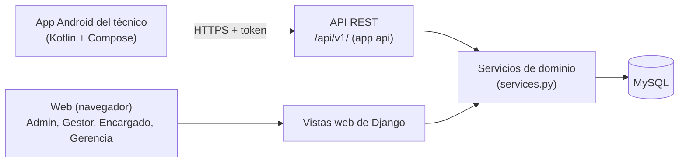
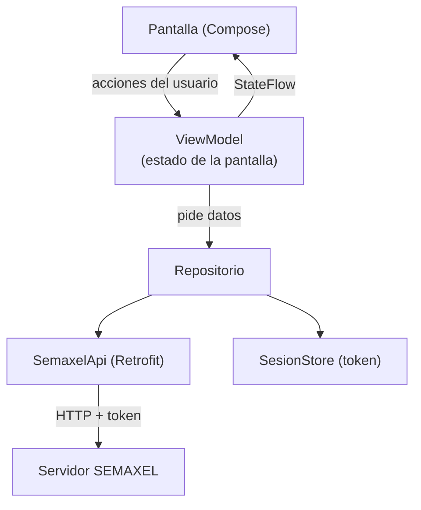

# Bitácora de desarrollo: app móvil del técnico

Registro paso a paso de lo que se va agregando a SEMAXEL para la app móvil del
técnico. Se actualiza **en cada parte**, en el mismo push que el código (primero el
commit del código y luego el de la bitácora, que cita su número), para que el
historial de Git y esta bitácora siempre coincidan.

- **Rama:** `feature/app-movil` (el código no entra a `main` hasta revisarlo).
- **Autor de los commits:** Sebastián Maturana, con apoyo de IA (Claude).
- **Documentos relacionados:** Documento A (modelo de alta), Documento B
  (solicitud de cambio de alcance) y la
  [Guía de la API](Guia_API_App_Movil.md), en esta misma carpeta.
- **Datos:** todos los datos de ejemplo (empresas, locales, personas) son
  hipotéticos.

---

## Cómo leer esta bitácora

Cada parte tiene la misma estructura:

1. **Objetivo:** qué problema resuelve.
2. **Qué se agregó:** archivos tocados y para qué.
3. **Cómo funciona:** el flujo explicado en simple.
4. **Decisiones:** qué se eligió y por qué (lo que hay que saber defender).
5. **Pruebas:** qué se verifica automáticamente.
6. **Probarlo a mano:** comandos para verlo funcionar.

---

## Estado general

| Parte | Qué agrega | Commit | Pruebas totales | Estado |
|---|---|---|---|---|
| 0 | Preparación del entorno en el equipo Windows | (sin commit) | 97 | Hecho |
| 1 | Django REST Framework e inicio de sesión por token | `e555546` | 113 | Hecho |
| 2 | Ofertas disponibles para el técnico | `0d85325` | 123 | Hecho |
| 3 | Tomar una oferta (regla compartida web y API) | `17ebc38` | 135 | Hecho |
| 4 | Mis trabajos: listar y avanzar órdenes (corrige el bug de Gerencia) | `cce1d41` | 160 | Hecho |
| 5 | API completa: coordenadas y horario, llegada GPS, fotos, firma, disponibilidad, inicio, notificaciones push y documentación OpenAPI | `014ec6d` | 195 | Hecho |
| 6 | Proyecto Android: base, login, navegación, Inicio y Perfil | `6813f62` | 195 + 11 de la app | Hecho, **sin compilar** |
| 7 | Pantallas Inicio, Ofertas y Mis trabajos | — | — | Pendiente |
| 8 | Cámara, GPS y firma en la app | — | — | Pendiente |
| 9 | Notificaciones push en la app (Firebase) | — | — | Pendiente |
| 10 | Servidor de pruebas en el equipo Windows (MySQL, puertos, archivos) | — | — | Pendiente |

Con la parte 5 **la API queda completa**: todo lo que la app necesita del
servidor ya existe, está probado y documentado. Lo que sigue es la app Android.

---

## Panorama: cómo encaja todo



Idea central: **las reglas de negocio viven en los servicios**, no en las vistas.
La web y la API son dos "puertas de entrada" que llaman a la misma regla. Así,
si una regla cambia, cambia para las dos al mismo tiempo.

La app **nunca** se conecta directo a MySQL: todo pasa por la API, que aplica los
mismos permisos que la web.

---

## Parte 0: preparación del entorno (13-11-2026)

**Objetivo.** Poder ejecutar y probar el proyecto en el equipo Windows, que
además será el servidor de pruebas para el celular.

**Qué se hizo.**

- Se clonó el repositorio en `D:\proyecto_semaxel` y se creó la rama
  `feature/app-movil` desde `main`.
- Se creó el entorno virtual `venv/` (ya estaba en `.gitignore`, no se sube) y se
  instalaron las dependencias de `requirements.txt`.
- Este equipo **no tiene MySQL**. Para correr las pruebas se usa una
  configuración temporal con SQLite en memoria, que **no se sube** al
  repositorio. Las 97 pruebas originales pasaron así antes de cambiar nada (es
  la línea base).

**Pendiente.** Instalar MySQL en este equipo y repetir las pruebas sobre MySQL
(ver parte 10).

---

## Parte 1: Django REST Framework e inicio de sesión (commit `e555546`)

**Objetivo.** Que la app pueda identificar al técnico antes de mostrarle nada.

**Qué se agregó.**

| Archivo | Para qué |
|---|---|
| `requirements.txt` | Agrega `djangorestframework==3.16.1`. |
| `config/settings.py` | Activa `rest_framework` y `rest_framework.authtoken`, y define la configuración `REST_FRAMEWORK`. |
| `config/urls.py` | Monta la API en `/api/v1/`. |
| `api/` (app nueva) | `views.py`, `serializers.py`, `permissions.py`, `urls.py` y `tests.py`. No tiene modelos propios. |

**Cómo funciona.**

1. La app envía usuario y contraseña a `POST /api/v1/auth/login/`, los mismos
   que se usan en la web.
2. Si son correctos y es un **técnico habilitado**, el servidor responde con un
   **token** y el perfil del técnico.
3. La app guarda el token y lo envía en cada petición siguiente, en la cabecera
   `Authorization: Token <token>`.
4. `POST /api/v1/auth/logout/` borra el token: deja de servir.
5. `GET /api/v1/auth/perfil/` devuelve los datos del técnico.

**Técnico habilitado** (`api/permissions.py`) significa que se cumplen las tres
condiciones: la cuenta está activa, el rol es TECNICO y el perfil de técnico no
está INACTIVO.

**Decisiones.**

- **Token y no sesión del navegador.** El celular no maneja cookies como un
  navegador; el token es el método estándar para apps. Además, la API ignora la
  sesión web, así que no depende de cookies ni de CSRF.
- **Mismo mensaje de error** si el usuario no existe o si la contraseña está mal:
  así nadie puede averiguar qué usuarios existen.
- **403 para otros roles.** La app es solo para técnicos; el resto usa la web.
- **Un token por usuario.** Si el técnico inicia sesión dos veces, recibe el
  mismo token.

**Pruebas (16 nuevas).** Login correcto, contraseña incorrecta, usuario
inexistente, datos faltantes, otros roles, técnico inactivo, rol técnico sin
perfil, cuenta desactivada, perfil con y sin token, token falso, logout y que la
sesión web no sirva para la API.

---

## Parte 2: ofertas disponibles (commit `0d85325`)

**Objetivo.** Que la sección Ofertas de la app muestre los trabajos que el
técnico puede tomar.

**Qué se agregó.**

| Archivo | Para qué |
|---|---|
| `ofertas/services.py` | Función nueva `ofertas_disponibles_para(tecnico)`. |
| `api/serializers.py` | `OfertaSerializer`: qué datos de la oferta recibe la app. |
| `api/views.py` | `OfertasDisponiblesView` (listado) y `OfertaDetalleView` (detalle). |
| `api/urls.py` | `GET ofertas/` y `GET ofertas/<id>/`. |

**Cómo funciona.** Una oferta aparece en la app si cumple las tres condiciones:

1. Está DISPONIBLE (antes se expiran las vencidas, igual que en la web).
2. La categoría del ticket tiene una especialidad definida.
3. El técnico tiene esa especialidad.

En el detalle, el técnico también puede ver las ofertas que ya tomó. Cualquier
otra oferta responde 404.

**Decisiones.**

- **Solo las de su especialidad** (historia HU-09). Hallazgo: la web muestra
  todas las disponibles y valida la especialidad recién al tomar. La web **no**
  se cambió; queda como decisión del equipo.
- **404 y no 403** para ofertas ajenas: no se revela que existen.
- **Sin número interno del ticket** (por ejemplo, `SEMAXEL-00001`), igual que la
  web lo oculta al técnico.

**Pruebas (10 nuevas).** Filtra por especialidad, oculta las tomadas, expira las
vencidas, no expone el número del ticket, detalle propio y ajeno, sin token y
otro rol.

---

## Parte 3: tomar una oferta (commit `17ebc38`)

**Objetivo.** Que el técnico tome una oferta desde la app, usando **exactamente
la misma regla** que la web.

**Qué se agregó o cambió.**

| Archivo | Para qué |
|---|---|
| `ofertas/services.py` | `tomar_oferta()` y el error `OfertaNoTomable`. La regla sale de la vista web y queda aquí. |
| `ofertas/views.py` | La vista web `tomar` ahora llama al servicio (bajó de ~90 a ~40 líneas). |
| `api/views.py` y `api/urls.py` | `POST ofertas/<id>/tomar/`. |
| `ofertas/tests.py` | Pruebas del servicio (antes estaba vacío). |

**Cómo funciona.** `tomar_oferta(oferta, tecnico, usuario)` revisa, en este
orden:

| Si pasa esto | Código |
|---|---|
| Ya no está disponible (por ejemplo, otro la tomó) | `no_disponible` |
| Venció (queda marcada EXPIRADA) | `vencida` |
| El ticket no puede pasar a ejecución | `ticket_no_permite` |
| La categoría no tiene especialidad | `sin_especialidad` |
| El técnico no tiene la especialidad | `especialidad_no_coincide` |

Si algo falla, lanza `OfertaNoTomable` y no cambia nada. Si todo está bien: la
oferta queda TOMADA, se crea la orden ASIGNADA, el ticket pasa a EN_EJECUCION
(con su entrada en el historial) y el técnico queda OCUPADO.

- La **web** traduce el error a un mensaje y redirige como antes.
- La **API** responde `201` con la orden creada, `409` con `detail` y `codigo` si
  no se puede tomar, o `404` si no existe.

**Decisiones.**

- **Una sola regla para la web y la API.** Es el cambio técnico que pedía el
  Documento B (sección 3.2): evita que las dos versiones dejen de coincidir.
- **Bloqueo contra tomas simultáneas** (`select_for_update`): si dos técnicos
  toman la misma oferta al mismo tiempo, el segundo espera y recibe
  `no_disponible`. Antes, los dos podían quedarse con ella. Mejora también la
  web. Ojo: SQLite no ejercita este bloqueo; se comprobará con MySQL.
- **Solo POST en la API.** Tomar una oferta modifica datos, así que un `GET`
  responde 405.

**Pruebas (12 nuevas).** 6 del servicio (toma exitosa y cada código de error) y
6 de la API. Las 3 pruebas web que ya existían sobre tomar ofertas siguen
pasando sin cambios: así se demuestra que la web se comporta igual.

---

## Parte 4: Mis trabajos (commit `cce1d41`)

**Objetivo.** Que la sección Mis trabajos de la app liste las órdenes del
técnico y le permita **iniciar** y **resolver** el trabajo, con las mismas
reglas que la web.

**Qué se agregó o cambió.**

| Archivo | Para qué |
|---|---|
| `tickets/services.py` (nuevo) | `cambiar_estado_orden()`, `transiciones_permitidas()` y el error `TransicionNoPermitida`. Las reglas salen de `tickets/ordenes_views.py`. |
| `tickets/ordenes_views.py` | La web usa el servicio (el archivo bajó unas 120 líneas). |
| `api/serializers.py` | `OrdenSerializer`, `IniciarOrdenSerializer` y `ResolverOrdenSerializer`. |
| `api/views.py` y `api/urls.py` | Listado, detalle, iniciar y resolver. |
| `tickets/tests.py` | Pruebas del servicio y de la corrección de Gerencia (antes estaba vacío). |

**Cómo funciona.** La orden sigue esta máquina de estados:

```
ASIGNADA ──iniciar──► EN_EJECUCION ──resolver──► RESUELTA ──cerrar──► CERRADA
    └──────────── cancelar ────────────┘              (encargado, en la web)
```

| Quién | Qué puede hacer |
|---|---|
| Técnico de la orden | Iniciar (exige diagnóstico) y resolver (exige el trabajo realizado). |
| Admin, Gestor, Encargado | Todo, incluido cerrar (exige calificación de 1 a 5) y cancelar. |
| Gerencia | Nada: solo consulta. |

`cambiar_estado_orden(orden, destino, usuario, datos)` revisa en orden: que no
sea el mismo estado (`sin_cambio`), que la transición exista
(`transicion_invalida`), que el usuario pueda aplicarla (`sin_permiso`) y que
vengan los datos obligatorios (`falta_diagnostico`, `falta_trabajo`,
`falta_calificacion`). Si todo está bien, guarda los datos de trabajo, fija las
fechas de inicio o fin, mueve el ticket al estado equivalente con su entrada en
el historial, libera al técnico si no tiene otras órdenes activas y, al cerrar,
registra la calificación.

En la API, cada orden trae el campo `acciones` (`["iniciar"]`, `["resolver"]` o
`[]`) para que la app sepa qué botón mostrar sin repetir la máquina de estados.

**Decisiones.**

- **Endpoints con nombre de acción** (`iniciar/`, `resolver/`) en vez de uno
  genérico "cambiar estado": cada uno pide solo sus datos y es más fácil de usar
  desde la app y de explicar.
- **El técnico no cierra ni cancela desde la app**: cerrar exige la calificación
  del encargado, que sigue usando la web. Reabrir (de RESUELTA a EN_EJECUCION)
  tampoco está en la app por ahora.
- **Corrección del bug de Gerencia (H3).** Antes, Gerencia podía cerrar o
  cancelar órdenes aunque su perfil es de solo lectura. Ahora no ve el
  formulario de transición y, si intenta enviarlo igual, recibe 403. Es el único
  cambio de comportamiento de la web en esta parte.
- **Bloqueo de la fila** (`select_for_update`), igual que al tomar ofertas, para
  que dos cambios simultáneos no se pisen.
- **Errores por tipo**: 400 si faltan datos o son inválidos (por ejemplo, costo
  negativo), 404 si la orden no es suya y 409 si el estado actual no permite la
  acción.

**Pruebas (25 nuevas).** 13 del servicio (iniciar, resolver, cerrar, cancelar,
datos obligatorios, permisos, técnico que sigue ocupado con otra orden y
Gerencia), 3 de la web (Gerencia ve sin poder cambiar, recibe 403 al enviar y el
encargado sí puede) y 9 de la API.

---

## Parte 5: API completa (commit `014ec6d`)

**Objetivo.** Terminar de una vez todo lo que la app necesita del servidor, en
lugar de seguir en partes chicas, y dejarlo documentado para desarrollar la app
Android contra una API cerrada. La referencia para usarla es la
[Guía de la API](Guia_API_App_Movil.md); aquí se explica qué se hizo y por qué.

**Qué se agregó.**

| Área | Archivos | Qué hace |
|---|---|---|
| Sucursal | `sucursales/models.py`, `forms.py`, `admin.py`, migración `0005` | Latitud y longitud (validadas, juntas o ninguna) y tabla `HorarioSucursal` (un registro por día; sin registro = cerrado). Coordenadas en el formulario web; horario en el administrador. |
| Llegada con GPS | `tickets/models.py`, migración `0002`, `tickets/services.py` | Campos de llegada en la orden y `registrar_llegada()`: calcula la distancia con la fórmula de haversine y la marca como verificada si está dentro del radio (150 m, configurable). |
| SLA de respuesta | `tickets/models.py` | `tiempo_respuesta_minutos`, `sla_respuesta_minutos` y `sla_respuesta_cumplido`: desde la creación del ticket hasta la llegada, frente al tiempo máximo de respuesta de la política SLA. |
| Fotos | `EvidenciaOrden`, `agregar_evidencia()`, `eliminar_evidencia()` | Hasta 10 fotos por orden, máximo 8 MB, solo imágenes reales (Pillow), antes del cierre. |
| Firma | `FirmaConformidad`, `registrar_firma()` | Imagen del trazo y nombre de quien firma; una vez por orden, en ejecución o resuelta. |
| Disponibilidad | `tecnicos/services.py` | `cambiar_disponibilidad()`: Disponible o No disponible, salvo si está Ocupado o Inactivo. |
| Notificaciones | `api/models.py` (`Dispositivo`), `api/notificaciones.py`, `api/signals.py` | Registro de celulares y avisos al publicar una oferta (a técnicos de esa especialidad) y al cerrar o cancelar una orden. |
| API | `api/serializers.py`, `api/views.py`, `api/urls.py` | 9 operaciones nuevas (la API queda con 19 operaciones en 17 rutas) y los datos nuevos en ofertas y órdenes, incluido el campo `acciones`. |
| Documentación | `config/settings.py` (drf-spectacular) | Esquema OpenAPI en `/api/v1/schema/` y Swagger en `/api/v1/docs/`, generados desde el código. |
| Web | `templates/tickets/orden_detalle.html`, `tickets/ordenes_views.py`, `templates/sucursales/form.html` | Tarjeta "Registro en terreno" en el detalle de la orden (llegada, tiempo de respuesta frente al SLA, fotos y firma) y campos de coordenadas en la sucursal. |
| Datos de demostración | `seed_demo.py` | Coordenadas y horarios hipotéticos para las sucursales de prueba. |

**Cómo funciona.** El flujo completo de un trabajo desde la app:

1. Login → registra el celular para recibir avisos.
2. Recibe el aviso de una oferta nueva de su especialidad → la toma.
3. Llega al local → registra la llegada con GPS; el servidor la verifica contra
   las coordenadas de la sucursal y desde ahí se mide el tiempo de respuesta.
4. Inicia el trabajo con un diagnóstico → sube fotos.
5. El encargado firma en el celular del técnico → el técnico marca la orden
   como resuelta.
6. El encargado ve todo en la web y cierra la orden con calificación → el
   técnico recibe el aviso.

**Decisiones.**

- **El servidor calcula la distancia, no la app.** Si lo calculara la app, un
  celular modificado podría decir que está en el local sin estarlo. El servidor
  recibe la posición y decide.
- **"No verificable" en vez de rechazar.** Las sucursales antiguas no tienen
  coordenadas; la llegada se guarda igual y queda marcada así (Documento A,
  sección 6.3), para no bloquear el trabajo.
- **La llegada completa `fecha_respuesta` de la oferta.** Ese campo existía y
  nunca se llenaba (Reglas de negocio, sección 4): ahora el tiempo de respuesta
  del SLA se mide de verdad.
- **Notificaciones con señales de Django.** Se disparan al guardar ofertas y
  órdenes, sin tocar las vistas web, y solo después de confirmar la transacción
  (`on_commit`), para no avisar de algo que al final no se guardó. Un error al
  notificar nunca bloquea la operación.
- **Backends de notificación intercambiables.** `consola` (desarrollo, sin
  cuenta de Firebase), `memoria` (pruebas) y `fcm` (Firebase real). Así se pudo
  programar y probar todo sin depender todavía de la cuenta de Firebase.
- **Documentación generada desde el código** (drf-spectacular). La
  documentación no puede quedar desactualizada respecto de la API, porque sale
  de las mismas clases. Swagger permite probar cada operación desde el
  navegador.
- **Se valida que las fotos sean imágenes reales** (Pillow), no solo por la
  extensión del archivo.
- **Disponibilidad bloqueada si está Ocupado.** Lo libera el sistema al terminar
  sus órdenes; así no puede quedar "Disponible" con trabajos activos.

**Pruebas (35 nuevas).** Distancia (2), llegada (9), fotos (6), firma (3),
perfil, inicio y dispositivos (5), notificaciones (3), documentación (1),
coordenadas y horario de la sucursal (5) y la tarjeta web de terreno (1). Las
pruebas de órdenes de la parte 4 se ajustaron al nuevo campo `acciones`.

**Prueba de punta a punta.** Además de las pruebas automáticas, se levantó el
servidor con los datos de demostración y se recorrió el flujo completo con
llamadas reales: login, inicio, ofertas, tomar, llegada (verificada a 0 m),
iniciar, subir una foto (y descargarla), firma, resolver, registrar el celular,
intento de cambiar disponibilidad estando ocupado (409, correcto) y cierre de
sesión (el token deja de servir: 401). Swagger se revisó en el navegador.

**Migraciones.** `sucursales 0005`, `tickets 0002` y `api 0001`. Solo agregan
columnas y tablas; no borran ni cambian datos existentes.

---

## Parte 6: proyecto Android, login y navegación (commit `6813f62`)

**Objetivo.** Crear la app Android sobre la API ya terminada: estructura del
proyecto, conexión con el servidor, inicio de sesión y la navegación con las
cinco secciones. Queda en la carpeta `app-movil/` del repositorio, con su
propio [README](../../../../../app-movil/README.md).

> **Importante:** esta parte **no se ha compilado**. El equipo Windows no tiene
> el SDK de Android, así que el código se escribió y se revisó a mano. Hay que
> abrirlo en Android Studio (por ejemplo, en el Mac) y compilarlo antes de
> seguir; si aparecen errores, se corrigen en la siguiente parte.

**Qué se agregó.**

| Archivo o carpeta | Para qué |
|---|---|
| `settings.gradle.kts`, `build.gradle.kts`, `gradle/libs.versions.toml` | Configuración de Gradle y versiones de todas las bibliotecas en un solo lugar. |
| `gradle.properties` | Dirección del servidor (`semaxel.apiUrl`); por defecto, el emulador. |
| `data/remote/SemaxelApi.kt` | Las 19 operaciones de la API como funciones de Retrofit (ya están todas, aunque las pantallas usen solo algunas). |
| `data/remote/Modelos.kt` | El JSON de la API como clases de Kotlin. |
| `data/remote/ClienteApi.kt` | Agrega el token a cada petición; si el servidor responde 401, borra la sesión. |
| `data/remote/ErroresApi.kt` | Traduce los errores del servidor a mensajes para mostrar. |
| `data/local/SesionStore.kt` | Guarda el token en el celular (DataStore). |
| `data/Repositorio.kt`, `data/Resultado.kt` | Lo único que usan las pantallas: piden datos y reciben "éxito" o "error explicado". |
| `ui/SemaxelRaiz.kt` | Muestra el login o la app según haya token. |
| `ui/login/`, `ui/principal/`, `ui/inicio/`, `ui/perfil/` | Pantallas y su lógica (ViewModel). |
| `app/src/test/` | 11 pruebas unitarias que no necesitan emulador. |

**Cómo funciona.**



1. Al abrir la app, la pantalla raíz mira si hay un token guardado: si no hay,
   muestra el login; si hay, muestra la app.
2. En el login, el ViewModel pide al repositorio iniciar sesión. Si funciona,
   el repositorio guarda el token y la pantalla raíz cambia sola a la app.
3. Cada petición lleva el token. Si el servidor responde 401 (token borrado o
   técnico desactivado), el token se borra y la app vuelve sola al login.
4. La barra inferior tiene las cinco secciones del Documento B. Inicio muestra
   el resumen (`GET inicio/`) y Perfil, los datos del técnico, el interruptor de
   disponibilidad y el botón para cerrar sesión. Ofertas, Mis trabajos y
   Evidencias muestran por ahora un aviso de "próximamente".

**Decisiones.**

- **Arquitectura por capas (pantalla, ViewModel, repositorio, API)**, la
  recomendada por Google para Android. Las pantallas no saben de Retrofit ni del
  token, así que la lógica se puede probar con un repositorio falso (como en
  `LoginViewModelTest`).
- **Sin bibliotecas de inyección de dependencias** (como Hilt): un `Contenedor`
  simple crea los objetos una vez. Para el tamaño de esta app es suficiente y se
  explica en una página.
- **La sesión decide la pantalla, no la navegación.** Al depender solo de si
  hay token, nunca puede quedar una pantalla de la app abierta sin sesión.
- **DataStore para el token**: es el reemplazo actual de SharedPreferences.
  El token no se cifra en esta versión (ver H13).
- **Errores siempre explicados.** Toda llamada termina en "éxito" o en un
  mensaje que se puede mostrar: sin conexión, error de un campo, regla de
  negocio (409) o sesión vencida.
- **`explicitNulls = false`**: los campos opcionales vacíos no se envían,
  porque el servidor rechaza `null` en esos campos (hay una prueba de esto).
- **HTTP sin cifrar permitido** solo porque el servidor de pruebas aún no tiene
  HTTPS; está documentado en el propio archivo de configuración.

**Pruebas (11, en la app).** Traducción de errores (4), lectura del JSON real de
una orden y omisión de campos vacíos (3, incluida la regla de disponibilidad) y
la lógica del login con un repositorio falso (4). Se ejecutan con
`./gradlew testDebugUnitTest`. Como no se compiló, **todavía no se han
ejecutado**.

---

## Referencia rápida de la API

Todas las rutas empiezan con `/api/v1/` y responden JSON. Salvo el login, todas
exigen la cabecera `Authorization: Token <token>`.

| Método | Ruta | Qué hace | Respuestas |
|---|---|---|---|
| POST | `auth/login/` | Entrega el token (sin token) | 200, 400, 403 |
| POST | `auth/logout/` | Borra el token (y el celular, si se indica) | 204, 401 |
| GET | `auth/perfil/` | Perfil del técnico | 200, 401, 403 |
| PATCH | `auth/perfil/` | Cambia su disponibilidad | 200, 400, 401, 403, 409 |
| POST | `dispositivos/` | Registra el celular para avisos push | 200, 201, 400, 401, 403 |
| DELETE | `dispositivos/<id>/` | Quita un celular | 204, 401, 403, 404 |
| GET | `inicio/` | Resumen para la pantalla Inicio | 200, 401, 403 |
| GET | `ofertas/` | Ofertas que puede tomar | 200, 401, 403 |
| GET | `ofertas/<id>/` | Detalle de una oferta | 200, 401, 403, 404 |
| POST | `ofertas/<id>/tomar/` | Toma la oferta | 201, 401, 403, 404, 409 |
| GET | `ordenes/` | Sus órdenes (filtro opcional `?estado=`) | 200, 400, 401, 403 |
| GET | `ordenes/<id>/` | Detalle de una orden suya | 200, 401, 403, 404 |
| POST | `ordenes/<id>/iniciar/` | Inicia el trabajo | 200, 400, 401, 403, 404, 409 |
| POST | `ordenes/<id>/resolver/` | Marca como resuelta | 200, 400, 401, 403, 404, 409 |
| POST | `ordenes/<id>/llegada/` | Registra la llegada con GPS | 201, 400, 401, 403, 404, 409 |
| GET | `ordenes/<id>/evidencias/` | Lista las fotos | 200, 401, 403, 404 |
| POST | `ordenes/<id>/evidencias/` | Sube una foto (multipart) | 201, 400, 401, 403, 404, 409 |
| DELETE | `ordenes/<id>/evidencias/<id>/` | Elimina una foto | 204, 401, 403, 404, 409 |
| POST | `ordenes/<id>/firma/` | Firma de conformidad (multipart) | 201, 400, 401, 403, 404, 409 |
| GET | `schema/` y `docs/` | Esquema OpenAPI y Swagger (públicos) | 200 |

El detalle de cada operación, con ejemplos de entrada y salida, está en la
[Guía de la API](Guia_API_App_Movil.md) y en Swagger (`/api/v1/docs/`).

Significado de los códigos: 200/201/204 correcto; 400 datos inválidos; 401 falta
el token o no es válido; 403 no es un técnico habilitado; 404 no existe o no le
corresponde; 409 la acción no se puede hacer en el estado actual.

## Probarlo a mano

La forma más simple es Swagger: abrir `http://localhost:8000/api/v1/docs/`,
iniciar sesión con `auth/login/`, presionar **Authorize** y escribir `Token `
seguido del token. Desde la consola:

Con el servidor corriendo (`python manage.py runserver`) y los datos de
demostración cargados (`python manage.py seed_demo`, que crea técnicos como
`cdiaz` con la clave definida en la constante `PASS` de ese comando):

```bash
# 1. Iniciar sesión (reemplaza CLAVE por la del técnico de prueba)
curl -X POST http://localhost:8000/api/v1/auth/login/ -H "Content-Type: application/json" -d "{\"username\": \"cdiaz\", \"password\": \"CLAVE\"}"

# 2. Copiar el token de la respuesta y usarlo en las siguientes llamadas
curl http://localhost:8000/api/v1/ofertas/ -H "Authorization: Token PEGAR_TOKEN"

# 3. Tomar la oferta con id 1 (la respuesta trae el orden_id)
curl -X POST http://localhost:8000/api/v1/ofertas/1/tomar/ -H "Authorization: Token PEGAR_TOKEN"

# 4. Ver mis trabajos
curl http://localhost:8000/api/v1/ordenes/ -H "Authorization: Token PEGAR_TOKEN"

# 5. Registrar la llegada, iniciar y resolver la orden con id 1
curl -X POST http://localhost:8000/api/v1/ordenes/1/llegada/ -H "Authorization: Token PEGAR_TOKEN" -H "Content-Type: application/json" -d "{\"latitud\": \"-33.429500\", \"longitud\": \"-70.617700\"}"
curl -X POST http://localhost:8000/api/v1/ordenes/1/iniciar/ -H "Authorization: Token PEGAR_TOKEN" -H "Content-Type: application/json" -d "{\"diagnostico\": \"Enchufe derretido\"}"
curl -X POST http://localhost:8000/api/v1/ordenes/1/resolver/ -H "Authorization: Token PEGAR_TOKEN" -H "Content-Type: application/json" -d "{\"trabajo_realizado\": \"Cambio de enchufe\"}"

# 6. Subir una foto
curl -X POST http://localhost:8000/api/v1/ordenes/1/evidencias/ -H "Authorization: Token PEGAR_TOKEN" -F "imagen=@foto.jpg" -F "descripcion=Antes del cambio"
```

---

## Hallazgos y pendientes

Cosas encontradas durante el trabajo que quedan registradas para decidir:

| # | Hallazgo | Estado |
|---|---|---|
| H1 | La web muestra al técnico todas las ofertas, no solo las de su especialidad (HU-09). | Por decidir |
| H2 | En la web, "tomar oferta" se ejecuta con un enlace `GET`: un enlace malicioso podría hacer que un técnico tome una oferta sin querer. Arreglarlo exige cambiar el botón del template. | Por decidir |
| H3 | Gerencia podía cerrar o cancelar una orden de trabajo aunque es de solo lectura. | Corregido en la parte 4 |
| H4 | Este equipo no tiene MySQL; las pruebas se corren con SQLite. | Parte 10 |
| H5 | Los tokens de la API no vencen; si se pierde un celular, hay que borrar el token desde el admin. | Evaluar vencimiento |
| H6 | El registro de requisitos dice 95 pruebas (RNF-15), pero había 97 antes de este trabajo. | Corregir al actualizar requisitos |
| H7 | El traspaso decía que las fotos completan el RF-11, pero el RF-11 es "Asignación de encargados a sucursales". | Consultar al PO |
| H8 | En la web, si un técnico OCUPADO guarda su perfil, el formulario lo deja DISPONIBLE (el selector parte en "Disponible"). La API ya no lo permite (parte 5); la web sigue igual. | Por decidir |
| H9 | Django solo sirve las fotos (`/media/`) con `DEBUG=True`. Para la demostración hay que configurar el servidor web. | Parte 10 |
| H10 | El horario de la sucursal solo se edita desde el administrador de Django; falta un formulario en la web. | Por decidir |
| H11 | Las notificaciones push quedan en modo `consola` hasta crear el proyecto en Firebase y configurar `FCM_CREDENTIALS_FILE`. | Parte 9 |
| H12 | La app Android no se ha compilado (este equipo no tiene SDK de Android). Falta también `gradlew` y su `.jar`, que Android Studio crea al abrir el proyecto. | Compilar en Android Studio |
| H13 | El token se guarda sin cifrar en el celular (DataStore). Para producción conviene cifrarlo con Android Keystore. | Evaluar |
