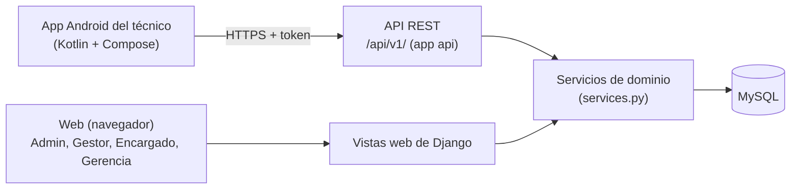
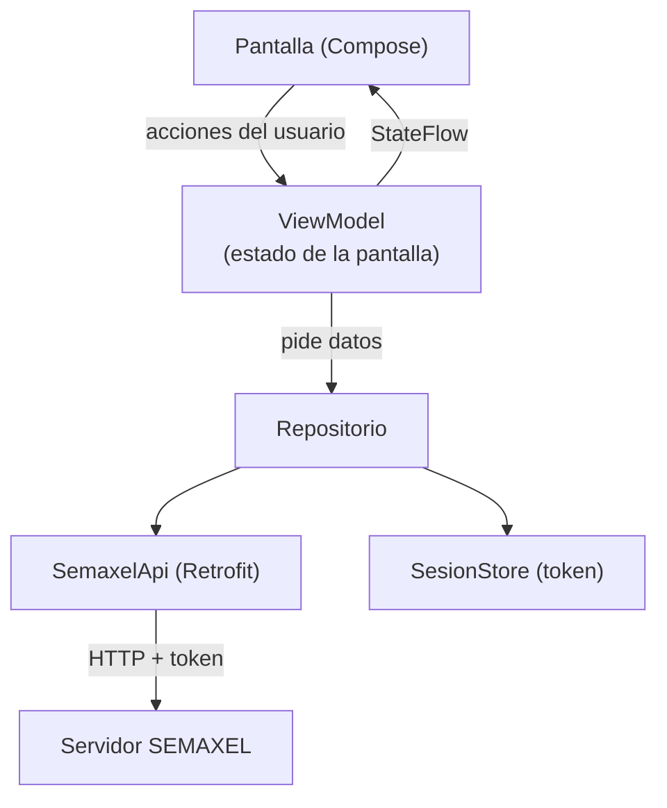
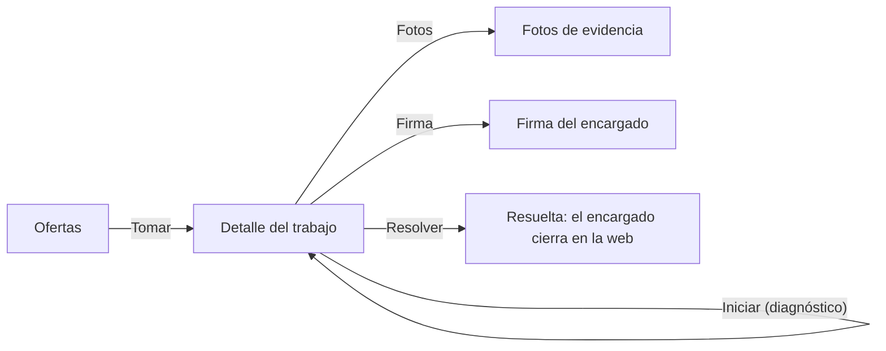

# Bitácora de desarrollo: app móvil del técnico

Registro paso a paso de lo que se va agregando a SEMAXEL para la app móvil del
técnico. Se actualiza **en cada parte**, en el mismo push que el código (primero el
commit del código y luego el de la bitácora, que cita su número), para que el
historial de Git y esta bitácora siempre coincidan.

- **Rama:** `feature/app-movil` (el código no entra a `main` hasta revisarlo).
- **Autor de los commits:** Sebastián Maturana, con apoyo de IA (Claude).
- **Documentos relacionados** (en esta misma carpeta): Documento A (modelo de
  alta), Documento B (solicitud de cambio de alcance), la
  [Guía de la API](Guia_API_App_Movil.md), la
  [Guía del entorno de desarrollo](Guia_Entorno_Desarrollo.md) (cómo está
  preparado el equipo y qué se instaló) y la
  [Guía del servidor de pruebas](Guia_Servidor_Pruebas.md) (MySQL, Waitress y
  acceso por la red) y la [Guía de pruebas manuales](Guia_Pruebas_QA.md)
  (perfil de QA y casos de prueba).
- **Datos:** todos los datos de ejemplo (empresas, locales, personas) son
  hipotéticos.

---

## Cómo leer esta bitácora

Cada parte tiene la misma estructura:

1. **Objetivo:** qué problema resuelve.
2. **Qué se agregó:** archivos tocados y para qué.
3. **Cómo funciona:** el flujo explicado en simple.
4. **Decisiones:** qué se eligió y por qué (lo que hay que saber defender).
5. **Pruebas:** qué se verifica automáticamente.
6. **Probarlo a mano:** comandos para verlo funcionar.

---

## Estado general

| Parte | Qué agrega | Commit | Pruebas totales | Estado |
|---|---|---|---|---|
| 0 | Preparación del entorno en el equipo Windows | (sin commit) | 97 | Hecho |
| 1 | Django REST Framework e inicio de sesión por token | `e555546` | 113 | Hecho |
| 2 | Ofertas disponibles para el técnico | `0d85325` | 123 | Hecho |
| 3 | Tomar una oferta (regla compartida web y API) | `17ebc38` | 135 | Hecho |
| 4 | Mis trabajos: listar y avanzar órdenes (corrige el bug de Gerencia) | `cce1d41` | 160 | Hecho |
| 5 | API completa: coordenadas y horario, llegada GPS, fotos, firma, disponibilidad, inicio, notificaciones push y documentación OpenAPI | `014ec6d` | 195 | Hecho |
| 6 | Proyecto Android: base, login, navegación, Inicio y Perfil | `6813f62` (compilado en `54d81c7`) | 195 + 11 de la app | Hecho |
| 7 | Pantallas Ofertas, Mis trabajos y Evidencias: tomar, GPS, iniciar, resolver, fotos y firma; prueba de contrato | `c1731e2` | 195 + 21 de la app | Hecho |
| 8 | Notificaciones push en la app (Firebase) | — | — | Pendiente |
| 9 | Servidor de pruebas: MySQL 8.4, Waitress, `DEBUG=False`, acceso por la red y APK para la red | `d35e859` | 195 (sobre MySQL) + 21 de la app | Hecho (falta abrir el firewall) |
| 9.1 | Emulador de Android: instalación, primera prueba en pantalla y dos arreglos visuales | `1f2ab48` | 195 + 21 de la app | Hecho (falta recorrer todos los flujos) |
| 9.2 | Perfil de QA (`preparar_qa`) y guía con 24 casos de prueba manuales | `6040bd6` | 201 + 21 de la app | Hecho (ampliado en la 9.3) |
| 9.3 | Datos falsos para probar todo: 9 usuarios (todos los roles), 2 empresas, 20 tickets en todos los estados, fotos, firmas, calificaciones, SLA y mantenimiento | `4638582` | 207 + 21 de la app | Hecho (pruebas manuales en curso) |
| 9.4 | Scripts para levantar y apagar todo y README actualizado | `38f2ead` | Scripts probados a mano | Hecho |
| 9.5 | `preparar_qa --agregar-trabajos`: más trabajos para probar sin reiniciar | `554b9e1` | 209 + 21 de la app | Hecho |
| 9.6 | Inicio, Ofertas y Trabajos se recargan al abrirlas; arreglo del error de "Trabajos" (consola en modo selección) | `1dffcbc` | 209 + 21 de la app | Hecho |
| 9.7 | Android Studio Rabbit 2 en D: con script para abrirlo | `6db1dd0` | — | Hecho |
| 9.8 | WhatsApp a la sucursal, Trabajos como historial por mes, dinero generado en Perfil y sin pestaña Evidencias | `836ae0b` | 210 + 27 de la app | Hecho |
| 9.9 | Deslizar hacia abajo para actualizar (sin botón "Actualizar") | `61f3acd` | 210 + 27 de la app | Hecho |
| 9.10 | Web del técnico: solo tomar ofertas y contactar a la sucursal; avanzar trabajos solo en la app | `2b93df3` | 214 + 27 de la app | Hecho |
| 9.11 | Manual de usuario v2 (con capturas reales y la app) y video de demostración de la app | `d0a1b81` | — | Hecho |
| 9.12 | Un técnico solo puede tener un trabajo activo a la vez | `a7cf872` | 219 + 27 de la app | Hecho |
| 10 | Prueba de la app en un celular y QA final | — | — | Pendiente |

Con la parte 5 **la API quedó completa** y con la parte 7 **la app cubre todo
el flujo del técnico**: ver ofertas, tomarlas, llegar con GPS, iniciar, subir
fotos, obtener la firma y resolver. Con la parte 9 el **servidor de pruebas**
funciona con MySQL y `DEBUG=False` en la red local, y con la parte 9.1 la app
**corre en el emulador** de este mismo equipo. Falta: recorrer todos los flujos
en el emulador, abrir el firewall (Sebastián) para probar en un celular y las
notificaciones push (requiere crear el proyecto de Firebase).

---

## Panorama: cómo encaja todo



Idea central: **las reglas de negocio viven en los servicios**, no en las vistas.
La web y la API son dos "puertas de entrada" que llaman a la misma regla. Así,
si una regla cambia, cambia para las dos al mismo tiempo.

La app **nunca** se conecta directo a MySQL: todo pasa por la API, que aplica los
mismos permisos que la web.

---

## Parte 0: preparación del entorno (13-11-2026)

**Objetivo.** Poder ejecutar y probar el proyecto en el equipo Windows, que
además será el servidor de pruebas para el celular.

**Qué se hizo.**

- Se clonó el repositorio en `D:\proyecto_semaxel` y se creó la rama
  `feature/app-movil` desde `main`.
- Se creó el entorno virtual `venv/` (ya estaba en `.gitignore`, no se sube) y se
  instalaron las dependencias de `requirements.txt`.
- Este equipo **no tiene MySQL**. Para correr las pruebas se usa una
  configuración temporal con SQLite en memoria, que **no se sube** al
  repositorio. Las 97 pruebas originales pasaron así antes de cambiar nada (es
  la línea base).

**Pendiente.** Instalar MySQL en este equipo y repetir las pruebas sobre MySQL
(ver parte 9).

---

## Parte 1: Django REST Framework e inicio de sesión (commit `e555546`)

**Objetivo.** Que la app pueda identificar al técnico antes de mostrarle nada.

**Qué se agregó.**

| Archivo | Para qué |
|---|---|
| `requirements.txt` | Agrega `djangorestframework==3.16.1`. |
| `config/settings.py` | Activa `rest_framework` y `rest_framework.authtoken`, y define la configuración `REST_FRAMEWORK`. |
| `config/urls.py` | Monta la API en `/api/v1/`. |
| `api/` (app nueva) | `views.py`, `serializers.py`, `permissions.py`, `urls.py` y `tests.py`. No tiene modelos propios. |

**Cómo funciona.**

1. La app envía usuario y contraseña a `POST /api/v1/auth/login/`, los mismos
   que se usan en la web.
2. Si son correctos y es un **técnico habilitado**, el servidor responde con un
   **token** y el perfil del técnico.
3. La app guarda el token y lo envía en cada petición siguiente, en la cabecera
   `Authorization: Token <token>`.
4. `POST /api/v1/auth/logout/` borra el token: deja de servir.
5. `GET /api/v1/auth/perfil/` devuelve los datos del técnico.

**Técnico habilitado** (`api/permissions.py`) significa que se cumplen las tres
condiciones: la cuenta está activa, el rol es TECNICO y el perfil de técnico no
está INACTIVO.

**Decisiones.**

- **Token y no sesión del navegador.** El celular no maneja cookies como un
  navegador; el token es el método estándar para apps. Además, la API ignora la
  sesión web, así que no depende de cookies ni de CSRF.
- **Mismo mensaje de error** si el usuario no existe o si la contraseña está mal:
  así nadie puede averiguar qué usuarios existen.
- **403 para otros roles.** La app es solo para técnicos; el resto usa la web.
- **Un token por usuario.** Si el técnico inicia sesión dos veces, recibe el
  mismo token.

**Pruebas (16 nuevas).** Login correcto, contraseña incorrecta, usuario
inexistente, datos faltantes, otros roles, técnico inactivo, rol técnico sin
perfil, cuenta desactivada, perfil con y sin token, token falso, logout y que la
sesión web no sirva para la API.

---

## Parte 2: ofertas disponibles (commit `0d85325`)

**Objetivo.** Que la sección Ofertas de la app muestre los trabajos que el
técnico puede tomar.

**Qué se agregó.**

| Archivo | Para qué |
|---|---|
| `ofertas/services.py` | Función nueva `ofertas_disponibles_para(tecnico)`. |
| `api/serializers.py` | `OfertaSerializer`: qué datos de la oferta recibe la app. |
| `api/views.py` | `OfertasDisponiblesView` (listado) y `OfertaDetalleView` (detalle). |
| `api/urls.py` | `GET ofertas/` y `GET ofertas/<id>/`. |

**Cómo funciona.** Una oferta aparece en la app si cumple las tres condiciones:

1. Está DISPONIBLE (antes se expiran las vencidas, igual que en la web).
2. La categoría del ticket tiene una especialidad definida.
3. El técnico tiene esa especialidad.

En el detalle, el técnico también puede ver las ofertas que ya tomó. Cualquier
otra oferta responde 404.

**Decisiones.**

- **Solo las de su especialidad** (historia HU-09). Hallazgo: la web muestra
  todas las disponibles y valida la especialidad recién al tomar. La web **no**
  se cambió; queda como decisión del equipo.
- **404 y no 403** para ofertas ajenas: no se revela que existen.
- **Sin número interno del ticket** (por ejemplo, `SEMAXEL-00001`), igual que la
  web lo oculta al técnico.

**Pruebas (10 nuevas).** Filtra por especialidad, oculta las tomadas, expira las
vencidas, no expone el número del ticket, detalle propio y ajeno, sin token y
otro rol.

---

## Parte 3: tomar una oferta (commit `17ebc38`)

**Objetivo.** Que el técnico tome una oferta desde la app, usando **exactamente
la misma regla** que la web.

**Qué se agregó o cambió.**

| Archivo | Para qué |
|---|---|
| `ofertas/services.py` | `tomar_oferta()` y el error `OfertaNoTomable`. La regla sale de la vista web y queda aquí. |
| `ofertas/views.py` | La vista web `tomar` ahora llama al servicio (bajó de ~90 a ~40 líneas). |
| `api/views.py` y `api/urls.py` | `POST ofertas/<id>/tomar/`. |
| `ofertas/tests.py` | Pruebas del servicio (antes estaba vacío). |

**Cómo funciona.** `tomar_oferta(oferta, tecnico, usuario)` revisa, en este
orden:

| Si pasa esto | Código |
|---|---|
| Ya no está disponible (por ejemplo, otro la tomó) | `no_disponible` |
| Venció (queda marcada EXPIRADA) | `vencida` |
| El ticket no puede pasar a ejecución | `ticket_no_permite` |
| La categoría no tiene especialidad | `sin_especialidad` |
| El técnico no tiene la especialidad | `especialidad_no_coincide` |

Si algo falla, lanza `OfertaNoTomable` y no cambia nada. Si todo está bien: la
oferta queda TOMADA, se crea la orden ASIGNADA, el ticket pasa a EN_EJECUCION
(con su entrada en el historial) y el técnico queda OCUPADO.

- La **web** traduce el error a un mensaje y redirige como antes.
- La **API** responde `201` con la orden creada, `409` con `detail` y `codigo` si
  no se puede tomar, o `404` si no existe.

**Decisiones.**

- **Una sola regla para la web y la API.** Es el cambio técnico que pedía el
  Documento B (sección 3.2): evita que las dos versiones dejen de coincidir.
- **Bloqueo contra tomas simultáneas** (`select_for_update`): si dos técnicos
  toman la misma oferta al mismo tiempo, el segundo espera y recibe
  `no_disponible`. Antes, los dos podían quedarse con ella. Mejora también la
  web. Ojo: SQLite no ejercita este bloqueo; se comprobará con MySQL.
- **Solo POST en la API.** Tomar una oferta modifica datos, así que un `GET`
  responde 405.

**Pruebas (12 nuevas).** 6 del servicio (toma exitosa y cada código de error) y
6 de la API. Las 3 pruebas web que ya existían sobre tomar ofertas siguen
pasando sin cambios: así se demuestra que la web se comporta igual.

---

## Parte 4: Mis trabajos (commit `cce1d41`)

**Objetivo.** Que la sección Mis trabajos de la app liste las órdenes del
técnico y le permita **iniciar** y **resolver** el trabajo, con las mismas
reglas que la web.

**Qué se agregó o cambió.**

| Archivo | Para qué |
|---|---|
| `tickets/services.py` (nuevo) | `cambiar_estado_orden()`, `transiciones_permitidas()` y el error `TransicionNoPermitida`. Las reglas salen de `tickets/ordenes_views.py`. |
| `tickets/ordenes_views.py` | La web usa el servicio (el archivo bajó unas 120 líneas). |
| `api/serializers.py` | `OrdenSerializer`, `IniciarOrdenSerializer` y `ResolverOrdenSerializer`. |
| `api/views.py` y `api/urls.py` | Listado, detalle, iniciar y resolver. |
| `tickets/tests.py` | Pruebas del servicio y de la corrección de Gerencia (antes estaba vacío). |

**Cómo funciona.** La orden sigue esta máquina de estados:

```
ASIGNADA ──iniciar──► EN_EJECUCION ──resolver──► RESUELTA ──cerrar──► CERRADA
    └──────────── cancelar ────────────┘              (encargado, en la web)
```

| Quién | Qué puede hacer |
|---|---|
| Técnico de la orden | Iniciar (exige diagnóstico) y resolver (exige el trabajo realizado). |
| Admin, Gestor, Encargado | Todo, incluido cerrar (exige calificación de 1 a 5) y cancelar. |
| Gerencia | Nada: solo consulta. |

`cambiar_estado_orden(orden, destino, usuario, datos)` revisa en orden: que no
sea el mismo estado (`sin_cambio`), que la transición exista
(`transicion_invalida`), que el usuario pueda aplicarla (`sin_permiso`) y que
vengan los datos obligatorios (`falta_diagnostico`, `falta_trabajo`,
`falta_calificacion`). Si todo está bien, guarda los datos de trabajo, fija las
fechas de inicio o fin, mueve el ticket al estado equivalente con su entrada en
el historial, libera al técnico si no tiene otras órdenes activas y, al cerrar,
registra la calificación.

En la API, cada orden trae el campo `acciones` (`["iniciar"]`, `["resolver"]` o
`[]`) para que la app sepa qué botón mostrar sin repetir la máquina de estados.

**Decisiones.**

- **Endpoints con nombre de acción** (`iniciar/`, `resolver/`) en vez de uno
  genérico "cambiar estado": cada uno pide solo sus datos y es más fácil de usar
  desde la app y de explicar.
- **El técnico no cierra ni cancela desde la app**: cerrar exige la calificación
  del encargado, que sigue usando la web. Reabrir (de RESUELTA a EN_EJECUCION)
  tampoco está en la app por ahora.
- **Corrección del bug de Gerencia (H3).** Antes, Gerencia podía cerrar o
  cancelar órdenes aunque su perfil es de solo lectura. Ahora no ve el
  formulario de transición y, si intenta enviarlo igual, recibe 403. Es el único
  cambio de comportamiento de la web en esta parte.
- **Bloqueo de la fila** (`select_for_update`), igual que al tomar ofertas, para
  que dos cambios simultáneos no se pisen.
- **Errores por tipo**: 400 si faltan datos o son inválidos (por ejemplo, costo
  negativo), 404 si la orden no es suya y 409 si el estado actual no permite la
  acción.

**Pruebas (25 nuevas).** 13 del servicio (iniciar, resolver, cerrar, cancelar,
datos obligatorios, permisos, técnico que sigue ocupado con otra orden y
Gerencia), 3 de la web (Gerencia ve sin poder cambiar, recibe 403 al enviar y el
encargado sí puede) y 9 de la API.

---

## Parte 5: API completa (commit `014ec6d`)

**Objetivo.** Terminar de una vez todo lo que la app necesita del servidor, en
lugar de seguir en partes chicas, y dejarlo documentado para desarrollar la app
Android contra una API cerrada. La referencia para usarla es la
[Guía de la API](Guia_API_App_Movil.md); aquí se explica qué se hizo y por qué.

**Qué se agregó.**

| Área | Archivos | Qué hace |
|---|---|---|
| Sucursal | `sucursales/models.py`, `forms.py`, `admin.py`, migración `0005` | Latitud y longitud (validadas, juntas o ninguna) y tabla `HorarioSucursal` (un registro por día; sin registro = cerrado). Coordenadas en el formulario web; horario en el administrador. |
| Llegada con GPS | `tickets/models.py`, migración `0002`, `tickets/services.py` | Campos de llegada en la orden y `registrar_llegada()`: calcula la distancia con la fórmula de haversine y la marca como verificada si está dentro del radio (150 m, configurable). |
| SLA de respuesta | `tickets/models.py` | `tiempo_respuesta_minutos`, `sla_respuesta_minutos` y `sla_respuesta_cumplido`: desde la creación del ticket hasta la llegada, frente al tiempo máximo de respuesta de la política SLA. |
| Fotos | `EvidenciaOrden`, `agregar_evidencia()`, `eliminar_evidencia()` | Hasta 10 fotos por orden, máximo 8 MB, solo imágenes reales (Pillow), antes del cierre. |
| Firma | `FirmaConformidad`, `registrar_firma()` | Imagen del trazo y nombre de quien firma; una vez por orden, en ejecución o resuelta. |
| Disponibilidad | `tecnicos/services.py` | `cambiar_disponibilidad()`: Disponible o No disponible, salvo si está Ocupado o Inactivo. |
| Notificaciones | `api/models.py` (`Dispositivo`), `api/notificaciones.py`, `api/signals.py` | Registro de celulares y avisos al publicar una oferta (a técnicos de esa especialidad) y al cerrar o cancelar una orden. |
| API | `api/serializers.py`, `api/views.py`, `api/urls.py` | 9 operaciones nuevas (la API queda con 19 operaciones en 17 rutas) y los datos nuevos en ofertas y órdenes, incluido el campo `acciones`. |
| Documentación | `config/settings.py` (drf-spectacular) | Esquema OpenAPI en `/api/v1/schema/` y Swagger en `/api/v1/docs/`, generados desde el código. |
| Web | `templates/tickets/orden_detalle.html`, `tickets/ordenes_views.py`, `templates/sucursales/form.html` | Tarjeta "Registro en terreno" en el detalle de la orden (llegada, tiempo de respuesta frente al SLA, fotos y firma) y campos de coordenadas en la sucursal. |
| Datos de demostración | `seed_demo.py` | Coordenadas y horarios hipotéticos para las sucursales de prueba. |

**Cómo funciona.** El flujo completo de un trabajo desde la app:

1. Login → registra el celular para recibir avisos.
2. Recibe el aviso de una oferta nueva de su especialidad → la toma.
3. Llega al local → registra la llegada con GPS; el servidor la verifica contra
   las coordenadas de la sucursal y desde ahí se mide el tiempo de respuesta.
4. Inicia el trabajo con un diagnóstico → sube fotos.
5. El encargado firma en el celular del técnico → el técnico marca la orden
   como resuelta.
6. El encargado ve todo en la web y cierra la orden con calificación → el
   técnico recibe el aviso.

**Decisiones.**

- **El servidor calcula la distancia, no la app.** Si lo calculara la app, un
  celular modificado podría decir que está en el local sin estarlo. El servidor
  recibe la posición y decide.
- **"No verificable" en vez de rechazar.** Las sucursales antiguas no tienen
  coordenadas; la llegada se guarda igual y queda marcada así (Documento A,
  sección 6.3), para no bloquear el trabajo.
- **La llegada completa `fecha_respuesta` de la oferta.** Ese campo existía y
  nunca se llenaba (Reglas de negocio, sección 4): ahora el tiempo de respuesta
  del SLA se mide de verdad.
- **Notificaciones con señales de Django.** Se disparan al guardar ofertas y
  órdenes, sin tocar las vistas web, y solo después de confirmar la transacción
  (`on_commit`), para no avisar de algo que al final no se guardó. Un error al
  notificar nunca bloquea la operación.
- **Backends de notificación intercambiables.** `consola` (desarrollo, sin
  cuenta de Firebase), `memoria` (pruebas) y `fcm` (Firebase real). Así se pudo
  programar y probar todo sin depender todavía de la cuenta de Firebase.
- **Documentación generada desde el código** (drf-spectacular). La
  documentación no puede quedar desactualizada respecto de la API, porque sale
  de las mismas clases. Swagger permite probar cada operación desde el
  navegador.
- **Se valida que las fotos sean imágenes reales** (Pillow), no solo por la
  extensión del archivo.
- **Disponibilidad bloqueada si está Ocupado.** Lo libera el sistema al terminar
  sus órdenes; así no puede quedar "Disponible" con trabajos activos.

**Pruebas (35 nuevas).** Distancia (2), llegada (9), fotos (6), firma (3),
perfil, inicio y dispositivos (5), notificaciones (3), documentación (1),
coordenadas y horario de la sucursal (5) y la tarjeta web de terreno (1). Las
pruebas de órdenes de la parte 4 se ajustaron al nuevo campo `acciones`.

**Prueba de punta a punta.** Además de las pruebas automáticas, se levantó el
servidor con los datos de demostración y se recorrió el flujo completo con
llamadas reales: login, inicio, ofertas, tomar, llegada (verificada a 0 m),
iniciar, subir una foto (y descargarla), firma, resolver, registrar el celular,
intento de cambiar disponibilidad estando ocupado (409, correcto) y cierre de
sesión (el token deja de servir: 401). Swagger se revisó en el navegador.

**Migraciones.** `sucursales 0005`, `tickets 0002` y `api 0001`. Solo agregan
columnas y tablas; no borran ni cambian datos existentes.

---

## Parte 6: proyecto Android, login y navegación (commit `6813f62`)

**Objetivo.** Crear la app Android sobre la API ya terminada: estructura del
proyecto, conexión con el servidor, inicio de sesión y la navegación con las
cinco secciones. Queda en la carpeta `app-movil/` del repositorio, con su
propio [README](../../../../../app-movil/README.md).

> **Compilación (14-11-2026).** El código se escribió primero sin compilar,
> porque el equipo Windows no tenía el SDK de Android. Después se instalaron en
> `D:\herramientas-android\` (el disco C: está casi lleno) el JDK 21, Gradle
> 8.11.1 y el SDK de Android 35, sin Android Studio. La app **compiló al primer
> intento, sin advertencias**, y las 11 pruebas unitarias pasaron. Se agregó el
> `gradlew` oficial al proyecto (commit `54d81c7`).

**Qué se agregó.**

| Archivo o carpeta | Para qué |
|---|---|
| `settings.gradle.kts`, `build.gradle.kts`, `gradle/libs.versions.toml` | Configuración de Gradle y versiones de todas las bibliotecas en un solo lugar. |
| `gradle.properties` | Dirección del servidor (`semaxel.apiUrl`); por defecto, el emulador. |
| `data/remote/SemaxelApi.kt` | Las 19 operaciones de la API como funciones de Retrofit (ya están todas, aunque las pantallas usen solo algunas). |
| `data/remote/Modelos.kt` | El JSON de la API como clases de Kotlin. |
| `data/remote/ClienteApi.kt` | Agrega el token a cada petición; si el servidor responde 401, borra la sesión. |
| `data/remote/ErroresApi.kt` | Traduce los errores del servidor a mensajes para mostrar. |
| `data/local/SesionStore.kt` | Guarda el token en el celular (DataStore). |
| `data/Repositorio.kt`, `data/Resultado.kt` | Lo único que usan las pantallas: piden datos y reciben "éxito" o "error explicado". |
| `ui/SemaxelRaiz.kt` | Muestra el login o la app según haya token. |
| `ui/login/`, `ui/principal/`, `ui/inicio/`, `ui/perfil/` | Pantallas y su lógica (ViewModel). |
| `app/src/test/` | 11 pruebas unitarias que no necesitan emulador. |

**Cómo funciona.**



1. Al abrir la app, la pantalla raíz mira si hay un token guardado: si no hay,
   muestra el login; si hay, muestra la app.
2. En el login, el ViewModel pide al repositorio iniciar sesión. Si funciona,
   el repositorio guarda el token y la pantalla raíz cambia sola a la app.
3. Cada petición lleva el token. Si el servidor responde 401 (token borrado o
   técnico desactivado), el token se borra y la app vuelve sola al login.
4. La barra inferior tiene las cinco secciones del Documento B. Inicio muestra
   el resumen (`GET inicio/`) y Perfil, los datos del técnico, el interruptor de
   disponibilidad y el botón para cerrar sesión. Ofertas, Mis trabajos y
   Evidencias muestran por ahora un aviso de "próximamente".

**Decisiones.**

- **Arquitectura por capas (pantalla, ViewModel, repositorio, API)**, la
  recomendada por Google para Android. Las pantallas no saben de Retrofit ni del
  token, así que la lógica se puede probar con un repositorio falso (como en
  `LoginViewModelTest`).
- **Sin bibliotecas de inyección de dependencias** (como Hilt): un `Contenedor`
  simple crea los objetos una vez. Para el tamaño de esta app es suficiente y se
  explica en una página.
- **La sesión decide la pantalla, no la navegación.** Al depender solo de si
  hay token, nunca puede quedar una pantalla de la app abierta sin sesión.
- **DataStore para el token**: es el reemplazo actual de SharedPreferences.
  El token no se cifra en esta versión (ver H13).
- **Errores siempre explicados.** Toda llamada termina en "éxito" o en un
  mensaje que se puede mostrar: sin conexión, error de un campo, regla de
  negocio (409) o sesión vencida.
- **`explicitNulls = false`**: los campos opcionales vacíos no se envían,
  porque el servidor rechaza `null` en esos campos (hay una prueba de esto).
- **HTTP sin cifrar permitido** solo porque el servidor de pruebas aún no tiene
  HTTPS; está documentado en el propio archivo de configuración.

**Pruebas (11, en la app).** Traducción de errores (4), lectura del JSON real de
una orden y omisión de campos vacíos (3, incluida la regla de disponibilidad) y
la lógica del login con un repositorio falso (4). Se ejecutan con
`./gradlew testDebugUnitTest`: **11 de 11 pasan**. La compilación genera el
APK de depuración (`app-debug.apk`, 17 MB). Todavía no se ha probado en un
emulador ni en un celular: este equipo no tiene emulador.

---

## Parte 7: Ofertas, Mis trabajos y Evidencias (commit `c1731e2`)

**Objetivo.** Completar las tres secciones que mostraban "próximamente" para
que el técnico pueda hacer todo su trabajo desde la app.

**Qué se agregó.**

| Archivo o carpeta | Para qué |
|---|---|
| `ui/ofertas/` | Listado de ofertas y detalle (local, horario, mapa) con el botón **Tomar oferta** y confirmación. Al tomarla se abre la orden creada. |
| `ui/trabajos/` | Listado de órdenes (Activos / Todos) y detalle con **Registrar llegada (GPS)**, **Iniciar** (diagnóstico y costo estimado) y **Marcar como resuelto** (trabajo, observaciones y costo final). Muestra llegada, tiempo de respuesta frente al SLA, datos del trabajo y del local. |
| `ui/evidencias/` | Fotos de una orden (cámara o galería, cuadrícula y eliminar) y **firma de conformidad** dibujada con el dedo (`PanelFirma`). La sección Evidencias lista los trabajos abiertos. |
| `dispositivo/Ubicacion.kt` | Pide la posición actual al GPS y abre el local en la app de mapas. |
| `dispositivo/Imagenes.kt` | Crea el archivo temporal para la cámara y prepara la foto antes de subirla. |
| `ui/comun/Tarjetas.kt`, `Formato.kt`, `EstadoPantalla.kt` | Tarjetas de oferta y orden, mensajes, etiquetas de prioridad, formato de fechas (hora de Chile), pesos y horario. |
| `ui/principal/PantallaPrincipal.kt` | Rutas de detalle (`oferta/{id}`, `trabajo/{id}`, `trabajo/{id}/fotos`, `trabajo/{id}/firma`) con flecha para volver. |
| `data/Repositorio.kt` | Todas las operaciones de la API disponibles para las pantallas. |
| `data/local/Sesion.kt` | Interfaz del almacén del token, para probar la capa de datos sin Android. |
| `AndroidManifest.xml`, `res/xml/rutas_archivos.xml` | Permisos de ubicación y `FileProvider` para la cámara. |
| `gradle/libs.versions.toml` | Nuevas bibliotecas: Play Services Location, Coil (mostrar fotos) y ExifInterface. |

**Cómo funciona el flujo en la app.**



1. **Tomar una oferta:** se confirma en un diálogo; si otro técnico la tomó
   antes, se muestra el motivo que envía el servidor (409).
2. **Llegada:** al tocar el botón, la app pide permiso de ubicación (solo la
   primera vez), obtiene una posición actual de alta precisión y la envía. El
   servidor calcula la distancia al local y responde si la llegada quedó
   verificada. La pantalla muestra el resultado y el tiempo de respuesta
   frente al SLA.
3. **Fotos:** la cámara del sistema guarda la foto en un archivo temporal de la
   app. Antes de subirla, la app la endereza (según los datos EXIF de la
   cámara), la reduce a 1600 px por lado y la comprime en JPEG: una foto de
   varios MB queda en unos cientos de KB, lo que importa con datos móviles.
4. **Firma:** el encargado escribe su nombre y firma con el dedo; la firma se
   convierte en una imagen PNG con fondo blanco y se sube.
5. **Botones:** cada orden trae del servidor el campo `acciones` y la pantalla
   muestra solo esos botones. La app no repite las reglas de la máquina de
   estados.

**Decisiones.**

- **La cámara del sistema, no una cámara propia.** Es más simple, funciona en
  cualquier celular y no requiere el permiso de cámara (Android lo exige solo
  si la app usa la cámara directamente).
- **Posición actual, no la última conocida.** La última posición guardada
  puede ser de horas antes y en otro lugar; para validar la llegada se pide una
  nueva con alta precisión.
- **El permiso de ubicación se pide al usarlo**, no al abrir la app: así el
  técnico entiende para qué es.
- **Las fotos se procesan en el celular antes de subirlas** (tamaño y
  orientación), para ahorrar datos y respetar el límite de 8 MB del servidor.
- **Coil** para mostrar fotos desde la URL: maneja caché y memoria, algo que no
  conviene programar a mano.
- **Interfaz `Sesion`.** La capa de datos ya no depende de DataStore (Android),
  sino de una interfaz. En el celular se usa DataStore; en las pruebas, una
  versión en memoria. Esto permitió la prueba de contrato.

**Pruebas.**

- **20 pruebas unitarias** (11 anteriores + 9 nuevas): formato de fechas en
  hora de Chile, pesos y horario (3), tomar oferta con éxito y con 409 (2),
  iniciar, resolver con 409, llegada y errores del celular (4).
- **Prueba de contrato** (`ContratoApiTest`): usa la capa de datos real de la
  app (Retrofit, modelos JSON y repositorio) contra un servidor SEMAXEL real y
  recorre el flujo completo de un trabajo: login, inicio, ofertas, tomar (y
  comprobar que tomarla dos veces da `no_disponible`), llegada verificada,
  iniciar con costo, subir, eliminar y volver a subir una foto, firma,
  resolver, y cerrar sesión (después el servidor responde 401). **Pasó** contra
  el servidor de demostración (SQLite y `seed_demo`) el 14-11-2026. Sin
  servidor se omite, para no romper la compilación normal.
- Compila **sin advertencias**.

**Probarlo a mano.** Ver el [README de la app](../../../../../app-movil/README.md):
compilar con `./gradlew assembleDebug`, instalar el APK en un celular con
`adb install` y apuntar `semaxel.apiUrl` al servidor.

**Lo que no se probó.** Las pantallas no se han visto en un emulador ni en un
celular (este equipo no tiene emulador). La cámara, el GPS y la firma solo se
pueden probar en un dispositivo (H14).

---

## Parte 9: servidor de pruebas en el equipo Windows (commit `d35e859`)

**Objetivo.** Dejar el equipo Windows funcionando como servidor real (MySQL,
`DEBUG=False`, accesible por la red) para probar la app en un celular y hacer
la demostración. El detalle completo está en la
[Guía del servidor de pruebas](Guia_Servidor_Pruebas.md).

**Qué se hizo.**

| Paso | Detalle |
|---|---|
| MySQL 8.4.3 LTS | ZIP oficial, firma de Oracle verificada, instalado en `D:\herramientas-servidor\` (sin instalador ni servicio de Windows). Escucha solo en `127.0.0.1`. |
| Base y usuario | Base `capstone_semaxel` (`utf8mb4`) y usuario `semaxel` con claves aleatorias; las claves quedaron en `.env` y en `D:\herramientas-servidor\credenciales\`, nunca en Git. |
| `.env` | `DEBUG=False`, `SECRET_KEY` aleatoria, `ALLOWED_HOSTS` con la IP de la red (`192.168.100.10`). |
| Código (commit `d35e859`) | WhiteNoise (estáticos), Waitress (servidor web en Windows), interruptor `SEMAXEL_SERVIR_MEDIA` (fotos con `DEBUG=False`) y `.env.example` (no existía). |
| Datos | `migrate` y `seed_demo` sobre MySQL. |
| Scripts | `iniciar-mysql.ps1` e `iniciar-servidor.ps1` en `D:\herramientas-servidor\`. |
| APK | Compilado apuntando a `http://192.168.100.10:8000/`: `D:\herramientas-servidor\apk\SEMAXEL-Tecnico-red-local.apk`. |

**Decisiones.**

- **MySQL 8.4 LTS y no 8.0**: la 8.0 dejó de tener soporte en abril de 2026.
- **MySQL solo en `127.0.0.1`**: Django está en el mismo equipo, así que la base
  no necesita estar en la red. Solo se expone el puerto 8000 del servidor web.
- **Waitress y no `runserver`**: `runserver` es solo para desarrollo (Django lo
  advierte); Waitress es un servidor de producción que funciona en Windows.
- **`DEBUG=False`**: con `True`, un error mostraría el código y la
  configuración a cualquiera que entre.
- **WhiteNoise para estáticos y un interruptor para las fotos**: es lo mínimo
  para servir sin Nginx ni IIS. El interruptor viene apagado y queda
  documentado que en producción las fotos las sirve el servidor web.
- **La IA no tocó el firewall ni el router.** Son configuraciones de seguridad
  del equipo: quedan a cargo de Sebastián, con los comandos en la guía.

**Verificación.**

- **195 de 195 pruebas de Django pasan sobre MySQL 8.4.3** (antes solo con
  SQLite). Esto incluye las tomas de ofertas con `select_for_update`.
- La web responde por la IP de la red con `DEBUG=False`: login real con CSRF,
  dashboard, reportes, tickets, órdenes, ofertas, sucursales y mantenimiento.
  Una página inexistente da 404 sin información interna.
- **La prueba de contrato de la app pasa contra Waitress + MySQL** por la IP de
  la red, y las fotos subidas se descargan (200, `image/jpeg`).
- `check --deploy`: 4 avisos, todos por no tener HTTPS (esperado).

**Lo que falta (a cargo de Sebastián).** Crear la regla del firewall para el
puerto 8000 (o usar la VPN ZeroTier que ya tiene el equipo), instalar el APK en
un celular y probar. Antes de publicar en Internet: cambiar las contraseñas de
demostración (están en el repositorio, que es público) y considerar HTTPS.

---

## Parte 9.1: emulador de Android (commit `1f2ab48`)

**Objetivo.** Ver la app funcionando en pantalla sin depender de un celular ni
de abrir el firewall. Pedido por Sebastián el 15-11-2026.

**Qué se hizo.**

| Paso | Detalle |
|---|---|
| Instalación | Emulador 37.2.13 e imagen Android 15 (API 35) con Google APIs, en `D:\herramientas-android\sdk` (4,6 GB en D:). |
| Aceleración | Ya funcionaba: `emulator -accel-check` → WHPX instalado y usable. No se cambió nada de Windows. |
| Dispositivo virtual | `SEMAXEL_Pixel7_API35` en D:, con 4 GB de RAM y cámara trasera con escena virtual. |
| Scripts | `entorno.ps1` suma `ANDROID_AVD_HOME` y el emulador al `PATH`; nuevo `iniciar-emulador.ps1`. |
| Servidor | `10.0.2.2` agregado a `ALLOWED_HOSTS` en el `.env` (fuera de Git) y en la Guía del servidor. |

**Primera prueba en pantalla (prueba de humo).** Con MySQL y Waitress
corriendo, se instaló la app con `adb install`, se inició sesión con el técnico
de demostración `cdiaz` y la pantalla de Inicio mostró los datos del servidor
(1 oferta, 1 trabajo activo). Aparecieron dos problemas visuales, que se
corrigieron en el mismo commit:

| # | Problema | Causa | Arreglo |
|---|---|---|---|
| H18 | En la barra inferior, "Mis trabajos" se cortaba y se leía "Mis". | Con cinco pestañas el texto no cabe en una línea. | La pestaña dice "Trabajos"; el título de arriba sigue siendo "Mis trabajos" (`PantallaPrincipal.kt`). |
| H19 | La dirección se mostraba "Manuel Montt 555, Temuco, Temuco, Temuco". | La dirección ya traía la ciudad y la comuna es igual a la ciudad. | `Formato.direccion` no repite la comuna ni la ciudad si ya aparecen; prueba nueva en `FormatoTest`. |

Pruebas de la app: **21 unitarias pasan** (antes 20) y compila sin
advertencias.

**Evidencia** (capturas reales del emulador, carpeta `capturas/`):

- `emulador_01_login.png`: pantalla de inicio de sesión.
- `emulador_02_inicio_antes_arreglos.png`: Inicio con los dos problemas.
- `emulador_03_inicio_despues_arreglos.png`: Inicio ya corregido.

**Qué falta.** Recorrer a fondo todos los flujos en el emulador (tomar oferta,
llegada con GPS dentro y fuera del radio, iniciar, fotos, firma, resolver,
perfil y disponibilidad). Sebastián empezó a revisarla a mano en el emulador
el 15-11-2026.

**Ojo para probar el GPS.** En los datos de demostración, solo las sucursales
de Santiago (Providencia, Santiago Centro, Ñuñoa y Las Condes) tienen
coordenadas. Las de Temuco (Centro y Mall Plaza) no tienen, así que una llegada
a esas sucursales queda registrada como "no verificable" (hallazgo H20).

**Limpieza.** Se borró un emulador antiguo de 2024 que ocupaba 5,1 GB en C:
(ver la sección 3.6 de la Guía del entorno).

---

## Parte 9.2: perfil de QA para pruebas manuales (commit `6040bd6`)

**Objetivo.** Que Sebastián pueda probar a mano la app y la web con un usuario
y datos propios, sin mezclarse con los datos de demostración y pudiendo repetir
las pruebas desde cero. Pedido por Sebastián el 15-11-2026.

**Qué se hizo.**

| Archivo | Cambio |
|---|---|
| `dashboard/management/commands/preparar_qa.py` | Comando nuevo: crea `qa_tecnico` (app) y `qa_admin` (web) y seis tickets `QA-0001` a `QA-0006`, cada uno con un caso de prueba. Cada ejecución borra los tickets `QA-` anteriores (con sus fotos y firmas) y los recrea. |
| `dashboard/tests_preparar_qa.py` | 6 pruebas nuevas del comando. |
| `Guia_Pruebas_QA.md` | Guía nueva: usuarios, escenario, coordenadas para el GPS y 24 casos de prueba con la columna "Resultado" en blanco. |

**Decisiones.**

- **Contraseña aleatoria y fuera del repositorio.** El repositorio es público
  (hallazgo H15), así que la clave de QA no se escribe en el código: se genera
  al crear los usuarios y se guarda en
  `D:\herramientas-servidor\credenciales\qa.txt`.
- **Sucursales con coordenadas.** Los tickets de QA usan Providencia, Ñuñoa y
  Santiago Centro, que tienen latitud y longitud, para poder probar el radio
  de 150 m (las de Temuco no tienen, hallazgo H20).
- **Casos negativos a propósito.** `qa_tecnico` no tiene Climatización
  (QA-0004 no debe aparecer) y QA-0006 está vencida (tampoco debe aparecer).
- **QA-0005 ya tomada**, usando la misma regla que la app (`tomar_oferta`),
  para probar fotos y firma sin pasar por todo el flujo.
- **La columna "Resultado" queda en blanco.** La llena quien prueba; no se
  completa sin haber hecho la prueba.

**Verificación.**

- **201 de 201 pruebas de Django pasan sobre MySQL** (195 + 6 nuevas).
- Se ejecutó `preparar_qa` en la base del servidor de pruebas.
- Por la API, `qa_tecnico` inicia sesión y ve QA-0001, QA-0002 y QA-0003 (más
  dos ofertas de demo de sus especialidades); no ve QA-0004 ni QA-0006; tiene
  QA-0005 como trabajo activo.
- En la web, `qa_admin` inicia sesión y ve los tickets y órdenes de QA.

---

## Parte 9.3: datos falsos para probar todo (commit `4638582`)

**Objetivo.** Sebastián pidió datos falsos "para todo", para que se pueda
probar el sistema completo y no solo el flujo del técnico.

**Qué se hizo.** Se amplió `preparar_qa`:

| Antes (parte 9.2) | Ahora |
|---|---|
| 2 usuarios (`qa_tecnico`, `qa_admin`) | 9 usuarios: uno por rol (admin, gestor, encargado, gerencia), 4 técnicos en distintos estados y el admin de otra empresa |
| 6 tickets en sucursales de demo | 20 tickets en dos empresas de QA propias, en **todos** los estados del ticket y de la orden |
| Sin fotos, firmas ni calificaciones | Fotos y firmas reales (imágenes generadas), 4 calificaciones, 1 adjunto, SLA cumplidos, vencidos y fuera de plazo |
| — | 5 sucursales (con y sin GPS, con y sin horario, una inactiva), 4 planes de mantenimiento y 1 ticket preventivo, 1 celular registrado |

**Decisiones.**

- **Empresas de QA propias** (`QA` y `QAOTRA`): así el dashboard y los
  reportes de `qa_admin` muestran solo datos de QA, el reinicio puede borrar
  todo lo de QA sin tocar `seed_demo`, y se prueba que una empresa no ve los
  datos de otra.
- **Generados con las reglas reales** (`tomar_oferta`, `registrar_llegada`,
  `agregar_evidencia`, `registrar_firma`, `cambiar_estado_orden` y
  `generar_tickets_preventivos`): el historial, los estados y la
  disponibilidad de los técnicos quedan coherentes, como si alguien hubiera
  usado el sistema.
- **Fechas repartidas en las últimas semanas** para los trabajos terminados,
  con un caso fuera del SLA, para que los reportes muestren algo realista.
- **Sin notificaciones push** al preparar (se usa el modo "memoria").
- **Números de ticket con el formato del sistema** (`QA-00001`), para que los
  tickets creados a mano en la web sigan la misma secuencia.

**Verificación.**

- **207 pruebas de Django pasan sobre MySQL** (las 6 de la parte 9.2 se
  reemplazaron por 12 que cubren el escenario completo).
- Cargado en el servidor de pruebas. En la web, cada rol entra y ve lo que le
  corresponde: `qa_encargado` solo sus dos sucursales y sin acceso a
  Reportes (403); `qa_otra_admin` solo su empresa; `qa_admin` no ve la otra
  empresa.
- Por la API: `qa_admin` y `qa_tecnico_inactivo` no pueden entrar a la app
  (403); cada técnico ve solo las ofertas de sus especialidades; `qa_tecnico`
  tiene órdenes en los cinco estados; las fotos se descargan.
- La [Guía de pruebas manuales](Guia_Pruebas_QA.md) tiene ahora 51 casos (28
  de la app y 23 de la web), con la columna "Resultado" en blanco.

---

## Parte 9.4: scripts para levantar y apagar todo (commit `38f2ead`)

**Objetivo.** Sebastián pidió actualizar el README con el paso a paso para
levantar los servicios y hacer scripts donde se pudiera, para no escribir
tres comandos en tres ventanas cada vez.

**Qué se hizo.**

- Carpeta `scripts/` en el repositorio, para PowerShell de Windows:

  | Script | Qué hace |
  |---|---|
  | `levantar-todo.ps1` / `.cmd` | Abre MySQL, el servidor y el emulador, cada uno en su ventana, y espera a que cada uno responda antes de seguir. Opciones `-SinEmulador`, `-InstalarApp` y `-Desarrollo` |
  | `apagar-todo.ps1` / `.cmd` | Cierra el emulador (y los procesos que a veces quedan colgados), detiene el servidor y apaga MySQL con `mysqladmin shutdown` |
  | `estado.ps1` | Qué está corriendo y las direcciones para entrar |
  | `iniciar-mysql.ps1`, `iniciar-servidor.ps1`, `iniciar-emulador.ps1` | Cada servicio por separado |
  | `instalar-app.ps1` | Compila la app, la instala en el emulador (o en un celular por USB) y la abre |
  | `instalar.ps1` | Primera vez: `venv`, dependencias y `.env` con una `SECRET_KEY` nueva |
  | `preparar-datos.ps1` | `seed_demo` y `preparar_qa`, con la clave de QA guardada fuera de Git |

- `README.md` reescrito: inicio rápido, scripts, primera vez en un equipo
  nuevo (incluida la creación de la base y su usuario), usuarios de prueba,
  direcciones, pruebas automáticas y problemas frecuentes. También se corrigió
  la URL del repositorio, que decía `TU_USUARIO`.
- Los scripts antiguos de `D:\herramientas-servidor\` y
  `D:\herramientas-android\` (fuera del repositorio) ahora solo llaman a los
  nuevos, para que las instrucciones anteriores sigan sirviendo.

**Decisiones.**

- **Rutas configurables sin tocar los scripts.** Por defecto usan las del
  equipo de pruebas (`D:\herramientas-*`). Otro integrante copia
  `scripts/config.local.ejemplo.ps1` como `config.local.ps1` (ignorado por
  Git) y cambia las rutas, el servicio de MySQL (`MySQL80` si lo instaló con
  el instalador oficial) o el nombre del emulador.
- **Una ventana por servicio**, como antes: se ve el registro de cada uno y
  cerrar una ventana detiene solo ese servicio.
- **No repetir lo que ya corre:** cada script revisa el puerto o el emulador
  antes de abrir algo.
- **Las claves no pasan por la línea de comandos:** `apagar-todo` lee la clave
  de `root` del archivo de credenciales y se la pasa a `mysqladmin` por
  variable de entorno, que se borra al terminar.
- **El apagado solo detiene lo de SEMAXEL:** si el puerto 8000 lo ocupa otro
  programa, avisa y no lo toca.
- Los `.ps1` se guardan en UTF-8 con BOM para que Windows PowerShell 5.1 lea
  bien los acentos.

**Verificación (16-11-2026).**

- `levantar-todo.ps1 -InstalarApp` con todo apagado: MySQL, servidor y
  emulador quedaron arriba; la app se compiló, se instaló y quedó abierta en
  primer plano (`cl.semaxel.tecnico/.MainActivity`). Swagger respondió 200.
- Al repetirlo con todo arriba, cada paso dijo "Ya estaba corriendo".
- `levantar-todo.ps1 -SinEmulador -Desarrollo`: la web respondió con
  `runserver`.
- `apagar-todo.ps1`: emulador, servidor y MySQL apagados, sin procesos
  colgados.
- `instalar.ps1` en este equipo (ya instalado): no cambió el `.env`.
- `preparar-datos.ps1` **no se ejecutó**, para no reiniciar los datos de QA
  mientras Sebastián hace las pruebas manuales. Solo llama a `seed_demo` y a
  `preparar_qa`, que tienen sus propias pruebas.
- Los scripts no se probaron en un equipo con MySQL instalado como servicio
  ni con otras rutas.

**Incidente.** La primera versión de `apagar-todo` leía mal el archivo con la
clave de `root` de MySQL y el apagado falló. Al revisar el formato del
archivo, la clave quedó visible en la salida de un comando de la sesión con
la IA. No quedó en Git, y MySQL solo acepta conexiones desde el mismo equipo,
pero se recomendó cambiarla (hallazgo H21).

---

## Parte 9.5: más trabajos para probar sin reiniciar (commit `554b9e1`)

**Objetivo.** Durante las pruebas manuales, Sebastián ya había llevado todas
las órdenes activas de `qa_tecnico` a resueltas (quedaban 6 resueltas, 3
cerradas, 1 cancelada y ninguna activa) y pidió más trabajos.

**Qué se hizo.** Opción nueva `preparar_qa --agregar-trabajos` (y
`scripts\preparar-datos.ps1 -AgregarTrabajos`). A diferencia de
`preparar_qa` normal, **no borra nada**: suma un lote de 8 tickets para
`qa_tecnico`:

| Estado | Cantidad | Para probar |
|---|---|---|
| Orden asignada | 3 | Llegada dentro del radio, fuera del radio y en sucursal sin GPS |
| Orden en ejecución (con 2 fotos) | 2 | Fotos, firma y resolver; una con prioridad crítica |
| Oferta disponible | 3 | Tomar ofertas; una vence en 24 horas |

**Decisiones.**

- **No reiniciar:** reiniciar con `preparar_qa` habría devuelto los trabajos
  originales, pero borrando lo que Sebastián ya había probado. Con la opción
  nueva se conserva todo y se puede repetir cuando se vuelvan a acabar.
- **Numeración del sistema:** los tickets toman el siguiente número de la
  empresa con la misma función que usa la web (`_proximo_numero`), así no
  chocan con los existentes ni con los que se creen a mano.
- **Mismas reglas que el resto:** se crean con `_crear_ticket`, que usa
  `tomar_oferta`, `registrar_llegada`, `agregar_evidencia` y
  `cambiar_estado_orden`. Tampoco envían notificaciones push.
- **No toca usuarios ni clave:** si el entorno de QA no existe, avisa que hay
  que correr `preparar_qa` primero.

**Verificación (18-11-2026).**

- 2 pruebas nuevas en `dashboard/tests_preparar_qa.py` (14 en total, todas
  pasan sobre MySQL): agregar dos veces suma 16 tickets desde `QA-00019`, no
  borra los anteriores, suma 10 órdenes activas y 6 ofertas visibles para
  `qa_tecnico`, y no cambia la clave; sin entorno de QA, avisa.
- Cargado en el servidor de pruebas: `QA-00019` a `QA-00026`. `qa_tecnico`
  quedó con 3 órdenes asignadas, 2 en ejecución y 4 ofertas visibles; la app
  en el emulador muestra "5 Trabajos activos" y "4 Ofertas para ti".

---

## Parte 9.6: las pestañas se recargan solas y error de "Trabajos" (commit `1dffcbc`)

**Pedido.** Sebastián pidió que Inicio, Ofertas y Trabajos se actualicen al
abrirlas, y reportó que la pestaña Trabajos daba error.

**El error (hallazgo H22).** La app mostraba "No se pudo conectar con el
servidor" en Trabajos, y al tocar "Reintentar" funcionaba. El registro de la
app mostraba `SocketTimeoutException` (30 s sin respuesta). Se investigó:

1. La API respondía en 0,2 s con `curl`: no era la consulta.
2. Con dos peticiones seguidas por la misma conexión, la segunda no se
   respondía nunca. Un `runserver` nuevo en otro puerto respondía bien.
3. La ventana del servidor se llamaba **"Select SEMAXEL - Servidor web"**: se
   había hecho clic en ella y Windows la dejó en "modo selección" (QuickEdit),
   que congela la salida del programa. `runserver` escribe una línea por cada
   petición; el hilo que atendía la conexión se quedaba bloqueado al escribirla
   y la siguiente petición por esa conexión no se atendía. La app reutiliza
   conexiones, por eso fallaba a ratos.

No era un error de la app ni de la API. **Arreglo:** los scripts
`iniciar-mysql`, `iniciar-servidor` e `iniciar-emulador` desactivan el modo
selección de su ventana al abrirse (`Disable-ModoSeleccion` en
`scripts/_comun.ps1`). Para copiar texto de esas ventanas queda el menú de la
ventana (Editar > Marcar).

**La recarga al abrir.**

- Nuevo `RecargarAlMostrarse` (`ui/comun/Componentes.kt`): usa
  `LifecycleResumeEffect` y llama a `cargar()` cada vez que la pantalla queda
  a la vista: al tocar su pestaña, al volver desde un detalle (por ejemplo,
  después de resolver una orden) y al volver a la app.
- Lo usan Inicio, Ofertas, Trabajos y también Evidencias (comparte la lista
  de trabajos).
- Los ViewModels de esas listas ya no cargan al crearse (`init`), para no
  pedir lo mismo dos veces la primera vez.
- Al recargar no se borra lo que hay en pantalla: se reemplaza cuando llegan
  los datos nuevos, así no parpadea. En Inicio se cambió `cargar()` para no
  volver a la rueda de carga si ya había datos.

**Verificación (18-11-2026).**

- Pruebas unitarias de la app: pasan las 21.
- En el emulador, al tocar Ofertas, Trabajos, Inicio, Trabajos y Ofertas se
  hicieron 5 peticiones (una por cada vez), todas con 200 y entre 11 y 58 ms.
- Servidor reiniciado con el arreglo: 3 pares de peticiones por la misma
  conexión, todas respondidas en milisegundos.

---

## Parte 9.7: Android Studio (commit `6db1dd0`)

**Objetivo.** Sebastián preguntó cómo hacer más eficiente el ciclo de hacer
cambios y encontrar errores. Se recomendó Android Studio para la app (Live
Edit, vista previa, Logcat y depurador; VS Code no tiene buen soporte para
Kotlin y Compose) y Sebastián lo aprobó.

**Qué se hizo.**

- Se descargó el ZIP oficial de Android Studio Rabbit 2 (1,5 GB), se verificó
  (SHA-256 igual al publicado y firma de Google LLC) y se descomprimió en
  `D:\herramientas-android\android-studio`. Detalle en la Guía del entorno,
  sección 3.7.
- Script nuevo `scripts/abrir-android-studio.ps1` (y `.cmd`): abre Studio con
  `app-movil`, el SDK y el emulador del equipo, la configuración y cachés en
  D: y el JDK de D: para Gradle.
- README: sección "Desarrollar la app en Android Studio".
- Sebastián aceptó los avisos del primer inicio y el proyecto abrió.

**Decisiones.**

- **ZIP y no instalador:** no modifica Windows y queda junto al resto de las
  herramientas en D:.
- **Nada en C::** en la primera apertura Studio descargó un JDK de 457 MB a
  `C:\Users\<usuario>\.jdks` para ejecutar Gradle. Se cambió al JDK 21 de D:
  (el mismo de la consola), el script lo fija en cada apertura y la copia de
  C: se borró.

---

## Parte 9.8: WhatsApp, historial por mes, dinero generado y sin Evidencias (commit `836ae0b`)

**Pedido.** Sebastián pidió cinco cambios después de probar la app:

| Pedido | Qué se hizo |
|---|---|
| Botón de WhatsApp para escribirle a la sucursal cuando el técnico tomó el trabajo | Botón verde redondo con el globo de conversación en el **detalle** de cada trabajo activo, junto a "Local". (En la primera versión también estaba en las tarjetas de Inicio y Mis trabajos; Sebastián pidió dejarlo solo en el detalle.) Abre `https://wa.me/<teléfono>` con un mensaje listo: "Hola, le escribe el técnico de SEMAXEL asignado al trabajo "…" en …". |
| Que Inicio, Ofertas y Trabajos se refresquen al abrirlos | Ya estaba hecho en la parte 9.6. Ahora también Perfil (para que el dinero generado esté al día). |
| Trabajos como historial separado por mes | Mis trabajos muestra arriba **Activos** y debajo **Historial**, agrupado por mes (del más reciente al más antiguo), con la cantidad de trabajos y lo generado en cada mes. |
| En Perfil, el dinero generado en el mes, en el año y total | Tres métricas nuevas, calculadas por el servidor (campo `ganancias` del perfil). |
| Quitar la pestaña Evidencias | Quitada: la barra inferior queda con 4 pestañas. Las fotos y la firma siguen en el detalle de cada trabajo, que ya tenía sus botones. |

**Decisiones.**

- **Dinero generado = costo final de los trabajos resueltos o cerrados**, por
  la fecha de término (`fecha_fin`, hora de Chile). El sistema no registra
  pagos al técnico; el costo final es el monto que el técnico declara al
  resolver, así que es lo más cercano a "lo que generó". Las órdenes
  canceladas o sin costo final no suman. Se calcula en el servidor
  (`api/serializers.py`, `ganancias_de`) para que la app no repita reglas.
- **WhatsApp por enlace `wa.me`**, sin depender de que WhatsApp esté
  instalado: si está, se abre la conversación; si no, el navegador. El
  teléfono de la sucursal se pasa a formato internacional chileno
  (`+56 9 1234 5678` → `56912345678`); si no es válido, no aparece el botón.
  Solo en trabajos activos: en el historial ya no hace falta.
- **El logo se dibujó en la app** (globo redondo con la cola abajo a la
  izquierda y un teléfono, en el verde de WhatsApp). No es el archivo oficial;
  si se quiere el oficial hay que descargarlo de la guía de marca de WhatsApp.
- **Historial:** cada trabajo cuenta en el mes en que terminó; las
  canceladas, en el mes en que se asignaron.

**Ideas para el lugar de Evidencias** (pendiente de decidir): ver el final
de esta parte.

**Actualización: dinero oculto por ahora (commit `e296831`).** Sebastián pidió
sacar "lo de la plata" por ahora. La app ya no muestra las métricas de dinero
en Perfil ni los montos del historial (total del mes y costo de cada trabajo).
Se ocultó con un interruptor, `MOSTRAR_DINERO = false` en
`ui/comun/Formato.kt`, para poder volver a mostrarlo sin rehacer nada. El
servidor sigue entregando `ganancias` en el perfil (la API no cambia) y las
pruebas siguen cubriendo el cálculo. El detalle del trabajo mantiene el costo
estimado y el costo final, que son datos del trabajo y ya estaban antes.

**Verificación (18-11-2026).**

- Servidor: prueba nueva `test_perfil_muestra_ganancias_del_mes_anio_y_total`
  (mes, año y total; canceladas y en ejecución no cuentan). 210 pruebas de
  Django en total.
- App: 6 pruebas nuevas en `TrabajosHistorialTest` (teléfono a formato
  internacional, enlace de WhatsApp, agrupación por mes, mes en hora de
  Chile, lectura de `ganancias`). 27 pruebas de la app, todas pasan.
- En el emulador con `qa_tecnico`: el botón aparece en el detalle de los
  trabajos activos (no en las listas) y abre `wa.me` con el mensaje; Mis trabajos muestra "Historial ·
  Noviembre 2026 · 9 trabajo(s) · $5.156.000" y Octubre; Perfil muestra
  $5.156.000 / $5.208.000 / $5.208.000. Los montos incluyen un costo final de
  $5.000.000 que se ingresó en las pruebas manuales (QAOTRA-00002).
- `openapi_app_movil.yaml` regenerado con el campo `ganancias`.

**Ideas para reemplazar Evidencias.**

1. **Mapa:** las ofertas y los trabajos activos en un mapa, para ver qué
   queda cerca y planificar la ruta. Usa las coordenadas que ya tiene la API.
2. **Agenda de hoy:** los trabajos del día ordenados por SLA o por distancia,
   con el tiempo que queda para cumplir el SLA de cada uno.
3. **Notificaciones:** bandeja con los avisos recibidos (ofertas nuevas,
   trabajos cerrados, calificaciones). Se complementa con Firebase (parte 8).
4. **Calificaciones:** las notas y comentarios que dejaron las sucursales al
   cerrar los trabajos, con el promedio.

---

## Parte 9.9: deslizar hacia abajo para actualizar (commit `61f3acd`)

**Pedido.** Sacar el botón "Actualizar" y que la lista se actualice al
tirarla hacia abajo desde arriba, como en las apps móviles.

**Qué se hizo.**

- Componente `DeslizarParaActualizar` (`ui/comun/Componentes.kt`) sobre
  `PullToRefreshBox` de Material 3: al tirar hacia abajo aparece la rueda y
  se vuelve a pedir el dato al servidor.
- Se usa en Inicio, Ofertas, Mis trabajos y el detalle del trabajo. Se
  quitaron los cuatro botones "Actualizar".
- `cargar()` de esas pantallas devuelve el `Job` de la carga, para que la
  rueda desaparezca justo cuando llega la respuesta.
- Se mantiene la recarga automática al abrir cada pestaña (parte 9.6); el
  gesto sirve para actualizar sin salir de la pantalla.
- **Señal visible (commit `91d0daa`):** como el servidor responde en
  milisegundos, la rueda casi no se veía. Ahora se queda al menos 0,6 s y,
  al llegar los datos, la lista hace un parpadeo corto (baja a 30 % de
  opacidad y vuelve). Solo al deslizar: la recarga automática al abrir una
  pestaña no parpadea, para no distraer en cada cambio de pestaña.

**Verificación (18-11-2026).** Compila y pasan las 27 pruebas de la app. En
el emulador, tirar hacia abajo en Ofertas, Mis trabajos e Inicio hizo una
petición al servidor cada vez (200, entre 10 y 58 ms).

---

## Parte 9.10: la web del técnico solo para tomar ofertas y contactar (commit `2b93df3`)

**Pedido.** Que la web le sirva al técnico solo para tomar trabajos y
comunicarse con el cliente; todo lo demás, en el celular.

**Antes.** En la web el técnico podía, además de tomar ofertas, avanzar sus
órdenes (iniciar y resolver) con el formulario de transición, sin GPS, fotos
ni firma.

**Qué se hizo.**

| En la web el técnico… | Ahora |
|---|---|
| Ve y toma ofertas | Igual |
| Ve sus órdenes (lista y detalle) | Igual, pero el detalle no tiene formulario de transición: muestra "Este trabajo se avanza desde la app SEMAXEL Técnico" |
| Contacta a la sucursal | **Nuevo:** tarjeta "Contacto con la sucursal" en el detalle de la orden: WhatsApp con mensaje listo, llamar, correo de la sucursal y nombre y correo del encargado |
| Avanza la orden o cambia el estado del ticket | **Ya no:** el servidor responde 403 aunque se envíe el formulario a mano |

Los demás roles (administración, gestor, encargado, gerencia) no cambian. La
API de la app no cambia: el técnico sigue avanzando sus trabajos desde ahí.

**Decisiones.**

- El bloqueo está en las vistas web (`tickets/ordenes_views.py` y
  `tickets/views.py`), no en las reglas compartidas (`cambiar_estado_orden`),
  porque la app usa esas mismas reglas.
- El enlace de WhatsApp usa el mismo formato de teléfono que la app
  (`tickets/contacto.py`, igual que `WhatsApp.kt`).

**Verificación (18-11-2026).** 4 pruebas nuevas en `tickets/tests.py`
(`TecnicoEnLaWebTests`): el detalle no ofrece transiciones y muestra WhatsApp
y teléfono; el POST de transición y el de estado de ticket responden 403; el
formato del teléfono. 214 pruebas de Django, todas pasan. Se agregaron los
casos W-24 a W-26 a la Guía de pruebas QA.

---

## Parte 9.11: manual de usuario v2 y video de demostración (commit `d0a1b81`)

**Pedido.** (1) Dejar más bonito el «Manual de usuario final» (Word),
agregar lo nuevo, quitar lo que ya no aplica y poner capturas en cada
sección. (2) Un video de la app funcionando con datos de prueba, que se vea
como uso humano.

**Manual (`MANUAL DE USUARIO FINAL v2.docx` y `.pdf`).** Se entregó junto al
original en la carpeta Descargas de Sebastián (el original no se tocó; no
está en el repositorio).

- **Diseño:** portada con capturas de la web y la app, índice automático,
  títulos en el azul de SEMAXEL, tablas con encabezado de color, recuadros
  «Importante», encabezado y pie con número de página. 66 páginas.
- **45 figuras con capturas reales** tomadas con los datos de QA: reemplazan
  los 39 espacios «[CAPTURA DE PANTALLA …]» que tenía el original, más las de
  la app.
- **Contenido nuevo:** sección 12 «App móvil SEMAXEL Técnico» (iniciar
  sesión, navegación y deslizar para actualizar, ofertas, llegada con GPS y
  radio de 150 m, WhatsApp, iniciar, fotos con sus límites, firma, resolver,
  historial por mes, perfil y problemas frecuentes); la orden vista por el
  técnico en la web con el contacto de la sucursal; el registro en terreno
  visible en el detalle de la orden.
- **Correcciones:** el técnico ya no inicia ni resuelve desde la web
  (parte 9.10); Gerencia consulta órdenes pero no las cierra ni les cambia el
  estado (así funciona desde la corrección de la parte 4 y el manual decía lo
  contrario); las fotos del trabajo van en la orden (desde la app), no solo en
  el ticket. El dinero generado no se menciona porque está oculto.
- **Cómo se hizo:** `scripts/capturas-manual-web.py` toma las capturas de la
  web con Chrome sin ventana (crea la sesión de cada usuario de prueba con
  Django, sin escribir contraseñas); las de la app salen de
  `scripts/grabar-video-app.py --ensayo --capturas`. El Word se armó con
  python-docx y se revisó convertido a PDF con Word.

**Video (`SEMAXEL - demo app tecnico.mp4`, 1080×2400).** También en Descargas
(no se sube al repositorio por su tamaño). A pedido de Sebastián queda a
**velocidad 1,6×** (2 min 55 s); la grabación original a velocidad normal
(4 min 40 s) se guardó como `… (velocidad normal).mp4`. El guion usa 1,6× por
defecto (`--velocidad`).

- Recorre: iniciar sesión, Inicio, Ofertas (deslizar para actualizar), tomar
  una oferta, llegada con GPS (verificada a 0 m), botón de WhatsApp, iniciar
  con diagnóstico, foto con la cámara, firma del encargado, resolver, Mis
  trabajos con el historial por mes, Perfil.
- **Grabación automatizada, declarada como tal.** La maneja
  `scripts/grabar-video-app.py` con adb a ritmo humano: toques visibles en
  pantalla, escritura letra por letra con pausas variables, desplazamientos
  suaves y la firma dibujada como un trazo continuo. No se presenta como
  grabado a mano.
- Datos: entorno de QA (`preparar_qa --agregar-trabajos` para tener ofertas
  nuevas). Por los ensayos, `qa_tecnico` quedó con muchos trabajos activos de
  prueba.

**Hallazgo H23.** Al volver de «Fotos de evidencia» al detalle del trabajo,
el contador seguía en «Fotos de evidencia (0)» aunque la foto se subió: el
detalle no se recarga al volver (sí lo hacen las pestañas). Se ve en el
video. Pendiente: recargar el detalle al mostrarse, como las pestañas.

---

## Parte 9.12: un técnico, un trabajo activo (commit `a7cf872`)

**Pedido.** Que un técnico solo pueda tener un trabajo activo a la vez.

**Regla.** «Activo» es una orden **Asignada** o **En ejecución**. Al
resolverla (Resuelta), el técnico ya puede tomar otra; no tiene que esperar
a que el encargado la cierre.

**Qué se hizo.**

- En `ofertas/services.py` (`tomar_oferta`, la única regla de «tomar
  oferta», que usan la web y la API): si el técnico ya tiene una orden activa
  se rechaza con el mensaje «Ya tienes un trabajo activo: “…”. Termínalo
  (márcalo como resuelto) antes de tomar otro.» y el código `trabajo_activo`
  (409 en la API). La app y la web ya mostraban el mensaje de error del
  servidor, así que no hubo que cambiarlas.
- Se bloquea también la fila del técnico durante la toma: si toma dos ofertas
  al mismo tiempo (por ejemplo, web y app), la segunda espera y ve la orden
  de la primera.
- **Datos de QA (`preparar_qa`):** antes `qa_tecnico` tenía dos activos.
  Ahora tiene uno (QA-00008, en ejecución) y QA-00005 pasó a ser una oferta
  para probar la regla; QA-00013 de `qa_tecnico2` quedó asignada (sigue
  habiendo órdenes en todos los estados). Los trabajos activos se crean al
  final, después de los terminados. `--agregar-trabajos` ahora suma 7
  ofertas y un trabajo en ejecución solo si `qa_tecnico` está libre.
- Documentación: código `trabajo_activo` en la guía de la API y en el
  esquema OpenAPI; regla agregada al Manual de usuario v2.

**Verificación (18-11-2026).** 5 pruebas nuevas: con un trabajo asignado o en
ejecución no puede tomar otro (409 `trabajo_activo`, la oferta sigue
disponible); al resolverlo, sí; en la web también; `preparar_qa` deja un solo
activo por técnico. Se ajustó una prueba antigua cuyo técnico ya tenía una
orden asignada. 219 pruebas de Django, todas pasan. En el emulador,
`qa_tecnico` intentó tomar una oferta y la app mostró el mensaje.

**Ojo con la base de pruebas actual:** `qa_tecnico` tiene decenas de trabajos
activos creados antes de la regla (ensayos del video). No puede tomar ofertas
hasta resolverlos todos; `preparar_qa` reinicia los datos de QA con un solo
activo. El guion del video necesita a `qa_tecnico` libre para tomar la oferta.

---

## Referencia rápida de la API

Todas las rutas empiezan con `/api/v1/` y responden JSON. Salvo el login, todas
exigen la cabecera `Authorization: Token <token>`.

| Método | Ruta | Qué hace | Respuestas |
|---|---|---|---|
| POST | `auth/login/` | Entrega el token (sin token) | 200, 400, 403 |
| POST | `auth/logout/` | Borra el token (y el celular, si se indica) | 204, 401 |
| GET | `auth/perfil/` | Perfil del técnico | 200, 401, 403 |
| PATCH | `auth/perfil/` | Cambia su disponibilidad | 200, 400, 401, 403, 409 |
| POST | `dispositivos/` | Registra el celular para avisos push | 200, 201, 400, 401, 403 |
| DELETE | `dispositivos/<id>/` | Quita un celular | 204, 401, 403, 404 |
| GET | `inicio/` | Resumen para la pantalla Inicio | 200, 401, 403 |
| GET | `ofertas/` | Ofertas que puede tomar | 200, 401, 403 |
| GET | `ofertas/<id>/` | Detalle de una oferta | 200, 401, 403, 404 |
| POST | `ofertas/<id>/tomar/` | Toma la oferta | 201, 401, 403, 404, 409 |
| GET | `ordenes/` | Sus órdenes (filtro opcional `?estado=`) | 200, 400, 401, 403 |
| GET | `ordenes/<id>/` | Detalle de una orden suya | 200, 401, 403, 404 |
| POST | `ordenes/<id>/iniciar/` | Inicia el trabajo | 200, 400, 401, 403, 404, 409 |
| POST | `ordenes/<id>/resolver/` | Marca como resuelta | 200, 400, 401, 403, 404, 409 |
| POST | `ordenes/<id>/llegada/` | Registra la llegada con GPS | 201, 400, 401, 403, 404, 409 |
| GET | `ordenes/<id>/evidencias/` | Lista las fotos | 200, 401, 403, 404 |
| POST | `ordenes/<id>/evidencias/` | Sube una foto (multipart) | 201, 400, 401, 403, 404, 409 |
| DELETE | `ordenes/<id>/evidencias/<id>/` | Elimina una foto | 204, 401, 403, 404, 409 |
| POST | `ordenes/<id>/firma/` | Firma de conformidad (multipart) | 201, 400, 401, 403, 404, 409 |
| GET | `schema/` y `docs/` | Esquema OpenAPI y Swagger (públicos) | 200 |

El detalle de cada operación, con ejemplos de entrada y salida, está en la
[Guía de la API](Guia_API_App_Movil.md) y en Swagger (`/api/v1/docs/`).

Significado de los códigos: 200/201/204 correcto; 400 datos inválidos; 401 falta
el token o no es válido; 403 no es un técnico habilitado; 404 no existe o no le
corresponde; 409 la acción no se puede hacer en el estado actual.

## Probarlo a mano

La forma más simple es Swagger: abrir `http://localhost:8000/api/v1/docs/`,
iniciar sesión con `auth/login/`, presionar **Authorize** y escribir `Token `
seguido del token. Desde la consola:

Con el servidor corriendo (`python manage.py runserver`) y los datos de
demostración cargados (`python manage.py seed_demo`, que crea técnicos como
`cdiaz` con la clave definida en la constante `PASS` de ese comando):

```bash
# 1. Iniciar sesión (reemplaza CLAVE por la del técnico de prueba)
curl -X POST http://localhost:8000/api/v1/auth/login/ -H "Content-Type: application/json" -d "{\"username\": \"cdiaz\", \"password\": \"CLAVE\"}"

# 2. Copiar el token de la respuesta y usarlo en las siguientes llamadas
curl http://localhost:8000/api/v1/ofertas/ -H "Authorization: Token PEGAR_TOKEN"

# 3. Tomar la oferta con id 1 (la respuesta trae el orden_id)
curl -X POST http://localhost:8000/api/v1/ofertas/1/tomar/ -H "Authorization: Token PEGAR_TOKEN"

# 4. Ver mis trabajos
curl http://localhost:8000/api/v1/ordenes/ -H "Authorization: Token PEGAR_TOKEN"

# 5. Registrar la llegada, iniciar y resolver la orden con id 1
curl -X POST http://localhost:8000/api/v1/ordenes/1/llegada/ -H "Authorization: Token PEGAR_TOKEN" -H "Content-Type: application/json" -d "{\"latitud\": \"-33.429500\", \"longitud\": \"-70.617700\"}"
curl -X POST http://localhost:8000/api/v1/ordenes/1/iniciar/ -H "Authorization: Token PEGAR_TOKEN" -H "Content-Type: application/json" -d "{\"diagnostico\": \"Enchufe derretido\"}"
curl -X POST http://localhost:8000/api/v1/ordenes/1/resolver/ -H "Authorization: Token PEGAR_TOKEN" -H "Content-Type: application/json" -d "{\"trabajo_realizado\": \"Cambio de enchufe\"}"

# 6. Subir una foto
curl -X POST http://localhost:8000/api/v1/ordenes/1/evidencias/ -H "Authorization: Token PEGAR_TOKEN" -F "imagen=@foto.jpg" -F "descripcion=Antes del cambio"
```

---

## Hallazgos y pendientes

Cosas encontradas durante el trabajo que quedan registradas para decidir:

| # | Hallazgo | Estado |
|---|---|---|
| H1 | La web muestra al técnico todas las ofertas, no solo las de su especialidad (HU-09). | Por decidir |
| H2 | En la web, "tomar oferta" se ejecuta con un enlace `GET`: un enlace malicioso podría hacer que un técnico tome una oferta sin querer. Arreglarlo exige cambiar el botón del template. | Por decidir |
| H3 | Gerencia podía cerrar o cancelar una orden de trabajo aunque es de solo lectura. | Corregido en la parte 4 |
| H4 | Este equipo no tenía MySQL; las pruebas se corrían con SQLite. | Resuelto en la parte 9: 195 pruebas pasan sobre MySQL 8.4.3 |
| H5 | Los tokens de la API no vencen; si se pierde un celular, hay que borrar el token desde el admin. | Evaluar vencimiento |
| H6 | El registro de requisitos dice 95 pruebas (RNF-15), pero había 97 antes de este trabajo. | Corregir al actualizar requisitos |
| H7 | El traspaso decía que las fotos completan el RF-11, pero el RF-11 es "Asignación de encargados a sucursales". | Consultar al PO |
| H8 | En la web, si un técnico OCUPADO guarda su perfil, el formulario lo deja DISPONIBLE (el selector parte en "Disponible"). La API ya no lo permite (parte 5); la web sigue igual. | Por decidir |
| H9 | Django solo servía las fotos (`/media/`) con `DEBUG=True`. | Resuelto para la demo con `SEMAXEL_SERVIR_MEDIA` (parte 9); en producción, el servidor web |
| H10 | El horario de la sucursal solo se edita desde el administrador de Django; falta un formulario en la web. | Por decidir |
| H11 | Las notificaciones push quedan en modo `consola` hasta crear el proyecto en Firebase y configurar `FCM_CREDENTIALS_FILE`. | Parte 8 |
| H12 | La app Android no se había compilado y faltaba `gradlew`. | Resuelto: compila sin advertencias y `gradlew` está en el repositorio |
| H14 | La app aún no se ha probado a fondo en pantalla. La capa de datos se probó contra el servidor real (prueba de contrato, partes 7 y 9) y el login e Inicio en el emulador (parte 9.1); faltan los demás flujos, la cámara, el GPS y la firma. | En curso (emulador); celular en la parte 10 |
| H15 | Los usuarios de `seed_demo` comparten una contraseña escrita en el repositorio, que es público. Si el servidor se publica en Internet con esos datos, cualquiera podría entrar como administrador. | Cambiar contraseñas antes de publicar |
| H16 | El servidor funciona por HTTP: el token y las contraseñas viajan sin cifrar. | HTTPS antes de publicar en Internet |
| H17 | Falta la regla del firewall de Windows para el puerto 8000; sin ella, otros dispositivos no llegan al servidor. La IA no modifica la seguridad del equipo. | Sebastián (comando en la Guía del servidor) |
| H13 | El token se guarda sin cifrar en el celular (DataStore). Para producción conviene cifrarlo con Android Keystore. | Evaluar |
| H18 | La pestaña "Mis trabajos" se cortaba en la barra inferior. | Corregido en la parte 9.1 |
| H19 | La dirección repetía la ciudad ("Temuco, Temuco, Temuco"). | Corregido en la parte 9.1 |
| H20 | En `seed_demo`, las sucursales de Temuco (Centro y Mall Plaza) no tienen coordenadas: la llegada a esas sucursales queda "no verificable" y no sirve para probar el radio de 150 m. | Por decidir (agregar coordenadas hipotéticas) |
| H21 | La clave de `root` de MySQL del servidor de pruebas quedó visible en la salida de un comando de la sesión con la IA (parte 9.4). No está en Git y MySQL solo escucha en 127.0.0.1. | Cambiar la clave de `root` |
| H22 | La pestaña Trabajos daba "No se pudo conectar" a ratos: la ventana del servidor quedó en modo selección de Windows y congelaba `runserver`. | Corregido en la parte 9.6 (los scripts desactivan ese modo) |
| H23 | El detalle del trabajo no se recarga al volver de Fotos o Firma: el contador de fotos queda desactualizado (se ve en el video de la parte 9.11). | Pendiente |
