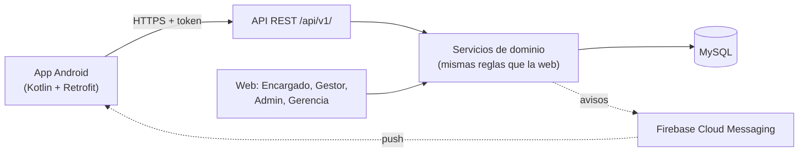
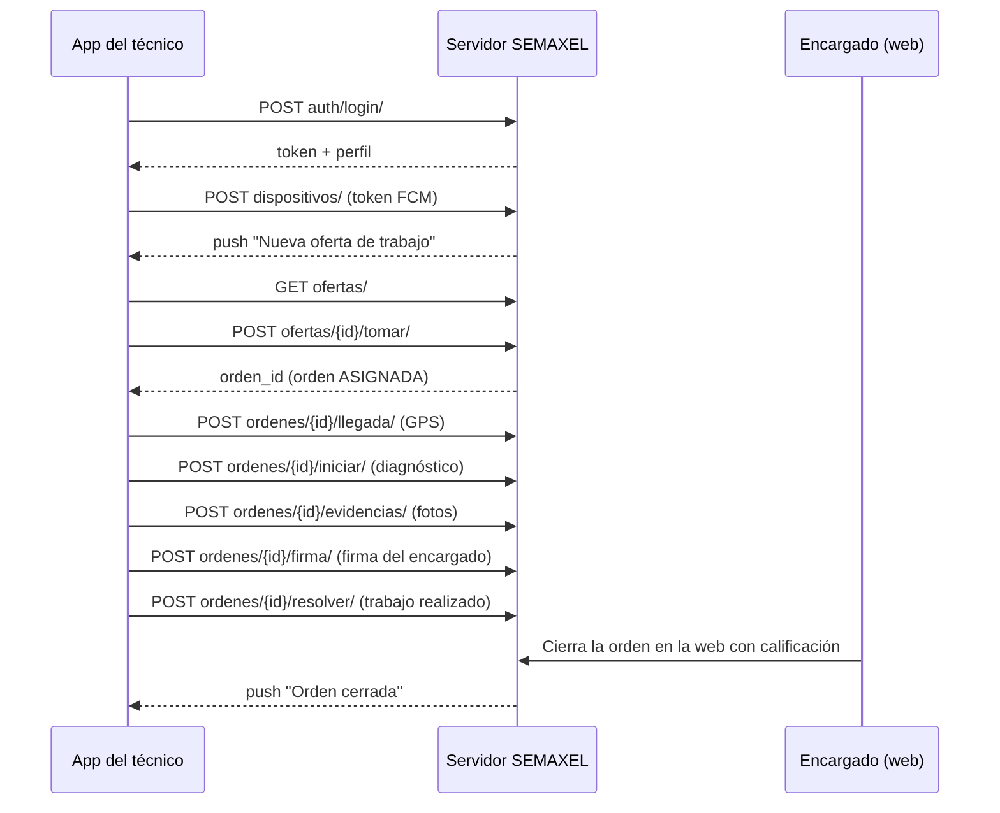

# Guía de la API de la app móvil del técnico

Versión 1.0 · 13-11-2026 · rama `feature/app-movil`

Esta guía explica cómo usar la API REST que consume la app Android del técnico
de terreno: cómo autenticarse, qué hace cada operación, qué responde y qué
reglas aplica. Está pensada para quien desarrolle la app y para quien tenga que
explicar el sistema.

- **Documentación interactiva (Swagger):** `http://<servidor>/api/v1/docs/`
  permite probar cada operación desde el navegador.
- **Esquema OpenAPI 3:** `http://<servidor>/api/v1/schema/`, y una copia en
  [`openapi_app_movil.yaml`](openapi_app_movil.yaml) en esta carpeta. Android
  Studio y otras herramientas pueden generar código cliente a partir de él.
- **Bitácora de desarrollo:** [`Bitacora_App_Movil.md`](Bitacora_App_Movil.md).

Todos los datos de los ejemplos son hipotéticos.

---

## 1. Conceptos básicos

| Tema | Regla |
|---|---|
| Dirección base | `/api/v1/` |
| Formato | JSON (UTF-8). Las fotos y la firma se envían como `multipart/form-data`. |
| Fechas | ISO 8601 con zona horaria, en hora de Chile (por ejemplo, `2026-11-13T15:42:10.512-03:00`). |
| Montos | Texto decimal con 2 decimales (por ejemplo, `"25000.00"`), para no perder precisión. |
| Coordenadas | Texto decimal con 6 decimales (por ejemplo, `"-33.437800"`). |
| Autenticación | Token en la cabecera `Authorization: Token <token>`. |
| Quién puede usarla | Solo técnicos habilitados: cuenta activa, rol TECNICO y perfil de técnico no INACTIVO. |

### Arquitectura



La API no repite reglas: llama a los mismos servicios que usa la web
(`ofertas/services.py`, `tickets/services.py`, `tecnicos/services.py`). Por
eso, una oferta tomada desde la app se ve tomada en la web y al revés.

---

## 2. Códigos de respuesta y errores

| Código | Significado | Qué hace la app |
|---|---|---|
| 200 / 201 / 204 | Correcto (201: se creó algo; 204: sin contenido). | Seguir. |
| 400 | Datos inválidos. El cuerpo trae un mensaje por campo: `{"diagnostico": ["Este campo es requerido."]}`. | Mostrar el error junto al campo. |
| 401 | Falta el token o ya no es válido. | Volver a la pantalla de inicio de sesión. |
| 403 | El usuario no es un técnico habilitado. | Cerrar sesión y avisar. |
| 404 | No existe o no le corresponde (una orden de otro técnico responde 404, no 403, para no revelar que existe). | Volver al listado. |
| 409 | Una regla de negocio no lo permite. El cuerpo trae `detail` (mensaje para mostrar) y `codigo` (para decidir qué hacer). | Mostrar `detail` y refrescar la pantalla. |

Ejemplo de 409:

```json
{"detail": "Esta oferta ya no está disponible.", "codigo": "no_disponible"}
```

Lista completa de códigos 409:

| Operación | Códigos |
|---|---|
| Tomar oferta | `no_disponible`, `vencida`, `ticket_no_permite`, `sin_especialidad`, `especialidad_no_coincide` |
| Iniciar / resolver | `sin_cambio`, `transicion_invalida`, `sin_permiso`, `falta_diagnostico`, `falta_trabajo` |
| Llegada, fotos y firma | `sin_permiso`, `orden_no_activa`, `llegada_ya_registrada`, `limite_evidencias`, `firma_ya_registrada` |
| Disponibilidad | `tecnico_ocupado`, `tecnico_inactivo` |

---

## 3. Flujo típico de un trabajo



Estados de la orden y quién los cambia:

```
ASIGNADA ──iniciar──► EN_EJECUCION ──resolver──► RESUELTA ──cerrar──► CERRADA
    └──────────────── cancelar ─────────────┘              (encargado, en la web)
```

La app no necesita conocer esta máquina de estados: cada orden trae el campo
`acciones` con los botones que corresponde mostrar.

| Valor en `acciones` | Cuándo aparece | Operación |
|---|---|---|
| `registrar_llegada` | Orden asignada o en ejecución, sin llegada registrada | `POST ordenes/{id}/llegada/` |
| `iniciar` | Orden asignada | `POST ordenes/{id}/iniciar/` |
| `resolver` | Orden en ejecución | `POST ordenes/{id}/resolver/` |
| `subir_evidencia` | Orden asignada, en ejecución o resuelta, con menos de 10 fotos | `POST ordenes/{id}/evidencias/` |
| `firmar` | Orden en ejecución o resuelta, sin firma | `POST ordenes/{id}/firma/` |

---

## 4. Operaciones

### 4.1 Sesión y perfil

#### `POST auth/login/` · Iniciar sesión (sin token)

```json
{"username": "cdiaz", "password": "********"}
```

Respuesta 200:

```json
{
  "token": "9944b09199c62bcf9418ad846dd0e4bbdfc6ee4b",
  "tecnico": {
    "id": 3,
    "username": "cdiaz",
    "nombre": "Carlos Díaz",
    "correo": "carlos.diaz@semaxel.cl",
    "telefono": "+56 9 1111 1111",
    "estado": "DISPONIBLE",
    "estado_display": "Disponible",
    "especialidades": ["Climatización", "Electricidad"]
  }
}
```

- 400 si el usuario o la contraseña son incorrectos (mismo mensaje en ambos
  casos, para no revelar qué usuarios existen).
- 403 si no es un técnico habilitado.
- Si el técnico ya tenía token, se le devuelve el mismo.

#### `POST auth/logout/` · Cerrar sesión

Cuerpo opcional: `{"token_dispositivo": "<token FCM>"}` para que ese celular
deje de recibir notificaciones. Responde 204 y el token deja de servir.

#### `GET auth/perfil/` · Ver mi perfil

Responde el objeto `tecnico` del login.

#### `PATCH auth/perfil/` · Cambiar mi disponibilidad

```json
{"estado": "NO_DISPONIBLE"}
```

Solo `DISPONIBLE` o `NO_DISPONIBLE`. Responde 409 `tecnico_ocupado` si tiene
órdenes activas (el sistema lo libera al terminarlas) y `tecnico_inactivo` si
un administrador lo inactivó.

### 4.2 Inicio

#### `GET inicio/` · Resumen para la pantalla Inicio

```json
{
  "tecnico": { "...": "igual que en el login" },
  "ofertas_disponibles": 2,
  "ordenes_activas": 1,
  "ordenes": [ { "...": "orden, ver 4.4" } ]
}
```

### 4.3 Ofertas

#### `GET ofertas/` · Ofertas que puedo tomar

Solo ofertas DISPONIBLES cuya categoría exige una especialidad que el técnico
tiene (historia HU-09). Antes de responder se expiran las vencidas.

```json
[
  {
    "id": 2,
    "estado": "DISPONIBLE",
    "titulo": "Reparación de tablero eléctrico",
    "descripcion": "El tablero principal se apaga solo.",
    "prioridad": "ALTA",
    "prioridad_display": "Alta",
    "categoria": "Eléctrica",
    "especialidad": "Electricidad",
    "empresa": "SEMAXEL Retail",
    "sucursal": {
      "nombre": "Providencia",
      "direccion": "Av. Providencia 1200",
      "comuna": "Providencia",
      "ciudad": "Santiago",
      "region": "Metropolitana",
      "telefono": "+56 2 2345 1000",
      "latitud": "-33.429500",
      "longitud": "-70.617700",
      "horario": [
        {"dia_semana": 0, "dia": "Lunes", "apertura": "09:00", "cierre": "20:00"}
      ]
    },
    "fecha_publicacion": "2026-11-13T10:00:00-03:00",
    "fecha_vencimiento": null,
    "observaciones": ""
  }
]
```

No se incluye el número interno del ticket (por ejemplo, `SEMAXEL-00001`),
igual que en la web. En `horario`, un día que no aparece está cerrado.

#### `GET ofertas/{id}/` · Detalle

Visible si la puede tomar o si ya la tomó él; si no, 404.

#### `POST ofertas/{id}/tomar/` · Tomar una oferta (sin cuerpo)

Respuesta 201: `{"orden_id": 6, "oferta": { ... }}`. Crea la orden ASIGNADA y
deja al técnico OCUPADO. Si dos técnicos toman la misma oferta al mismo tiempo,
solo uno lo logra; el otro recibe 409 `no_disponible`.

### 4.4 Mis trabajos

#### `GET ordenes/` · Mis órdenes

Filtro opcional `?estado=ASIGNADA` (o `EN_EJECUCION`, `RESUELTA`, `CERRADA`,
`CANCELADA`). Cada orden tiene esta forma:

```json
{
  "id": 6,
  "estado": "EN_EJECUCION",
  "estado_display": "En ejecución",
  "titulo": "Reparación de tablero eléctrico",
  "descripcion": "El tablero principal se apaga solo.",
  "prioridad": "ALTA",
  "prioridad_display": "Alta",
  "categoria": "Eléctrica",
  "empresa": "SEMAXEL Retail",
  "sucursal": { "...": "igual que en la oferta" },
  "diagnostico": "Falla revisada en terreno",
  "trabajo_realizado": "",
  "observaciones": "",
  "costo_estimado": null,
  "costo_final": null,
  "fecha_asignacion": "2026-11-13T15:40:02-03:00",
  "fecha_inicio": "2026-11-13T15:45:10-03:00",
  "fecha_fin": null,
  "llegada": {
    "fecha": "2026-11-13T15:42:10-03:00",
    "latitud": "-33.429500",
    "longitud": "-70.617700",
    "precision_m": 12.0,
    "distancia_m": 0,
    "verificada": true
  },
  "tiempo_respuesta_minutos": 32,
  "sla_respuesta_minutos": 60,
  "sla_respuesta_cumplido": true,
  "evidencias": [
    {"id": 1, "url": "http://<servidor>/media/evidencias_ordenes/2026/11/foto.png",
     "descripcion": "Antes", "fecha_subida": "2026-11-13T15:50:00-03:00"}
  ],
  "firma": null,
  "acciones": ["resolver", "subir_evidencia", "firmar"]
}
```

- `llegada` es `null` hasta que se registra.
- `tiempo_respuesta_minutos` va desde la creación del ticket hasta la llegada;
  `sla_respuesta_cumplido` lo compara con el tiempo máximo de respuesta de la
  política SLA (`null` si no hay llegada o no hay política).

#### `GET ordenes/{id}/` · Detalle de una orden

Misma forma. Las órdenes de otros técnicos responden 404.

#### `POST ordenes/{id}/iniciar/` · Iniciar el trabajo

```json
{"diagnostico": "Enchufe derretido", "costo_estimado": "12000"}
```

`diagnostico` es obligatorio; `costo_estimado` es opcional y no puede ser
negativo. Responde 200 con la orden actualizada.

#### `POST ordenes/{id}/resolver/` · Marcar como resuelta

```json
{"trabajo_realizado": "Cambio de enchufe", "observaciones": "", "costo_final": "25000"}
```

`trabajo_realizado` es obligatorio. El ticket pasa a RESUELTO y el técnico
queda disponible si no tiene otras órdenes activas. **El cierre lo hace el
encargado en la web**, con una calificación de 1 a 5.

#### `POST ordenes/{id}/llegada/` · Registrar llegada con GPS

```json
{"latitud": "-33.429500", "longitud": "-70.617700", "precision_m": 12}
```

- Se registra una sola vez, con la orden asignada o en ejecución.
- Si la sucursal tiene coordenadas, el servidor calcula la distancia (fórmula
  de haversine) y marca `verificada: true` si está dentro del radio permitido
  (150 m por defecto, configurable). Si la sucursal no tiene coordenadas,
  `verificada` queda en `null` ("no verificable").
- Completa la fecha de respuesta de la oferta, que antes nunca se llenaba, y
  deja una entrada en el historial del ticket.
- Responde 201 con la orden actualizada.

### 4.5 Evidencias y firma

#### `GET ordenes/{id}/evidencias/` · Fotos de la orden

#### `POST ordenes/{id}/evidencias/` · Subir una foto (multipart)

Campos: `imagen` (archivo JPG o PNG, máximo 8 MB) y `descripcion` (opcional).
El servidor comprueba que sea una imagen real. Se aceptan hasta 10 fotos por
orden, mientras esté asignada, en ejecución o resuelta. Responde 201 con la
evidencia.

#### `DELETE ordenes/{id}/evidencias/{evidencia_id}/` · Eliminar una foto

Solo quien la subió y antes del cierre. Responde 204.

#### `POST ordenes/{id}/firma/` · Firma de conformidad (multipart)

Campos: `imagen` (PNG con el trazo de la firma) y `nombre_firmante`. El
encargado firma en el celular del técnico al terminar. Una sola vez, con la
orden en ejecución o resuelta. Queda en el historial del ticket y el encargado
la ve en la web, en el detalle de la orden. Responde 201 con la orden.

### 4.6 Notificaciones push

#### `POST dispositivos/` · Registrar este celular

```json
{"token": "<token FCM>", "plataforma": "ANDROID"}
```

La app lo llama después del login y cada vez que Firebase renueva el token.
Responde 201 si es nuevo y 200 si ya existía.

#### `DELETE dispositivos/{id}/` · Quitar un celular

Avisos que envía el servidor (en `data` llega el tipo y el id para abrir la
pantalla correcta):

| Cuándo | Título | `data` |
|---|---|---|
| Se publica o republica una oferta de su especialidad | Nueva oferta de trabajo | `{"tipo": "oferta_nueva", "oferta_id": "12"}` |
| El encargado cierra su orden | Orden cerrada | `{"tipo": "orden_cerrada", "orden_id": "6"}` |
| El encargado cancela su orden | Orden cancelada | `{"tipo": "orden_cancelada", "orden_id": "6"}` |

---

## 5. Configuración del servidor

Variables de entorno (archivo `.env`):

| Variable | Valor por defecto | Para qué |
|---|---|---|
| `SEMAXEL_RADIO_LLEGADA_METROS` | `150` | Radio para dar por verificada la llegada. |
| `SEMAXEL_PUSH_BACKEND` | `consola` | `consola` escribe los avisos en el log; `fcm` los envía con Firebase. |
| `FCM_CREDENTIALS_FILE` | (vacío) | Ruta al JSON de la cuenta de servicio de Firebase. Solo con `fcm`. |
| `ALLOWED_HOSTS` | `localhost,127.0.0.1` | Agregar la IP o el dominio por el que entra el celular. |

Para activar Firebase: crear el proyecto en la consola de Firebase, descargar
la clave de la cuenta de servicio, instalar `google-auth` en el servidor
(`pip install google-auth`), definir `SEMAXEL_PUSH_BACKEND=fcm` y
`FCM_CREDENTIALS_FILE`. Un error al notificar nunca bloquea la operación que lo
originó.

En la web, las coordenadas se ingresan al crear o editar una sucursal. El
horario de atención se edita desde el administrador de Django, dentro de la
sucursal.

---

## 6. Probar la API

1. Con el servidor corriendo, abrir `http://<servidor>/api/v1/docs/`.
2. Ejecutar `POST /api/v1/auth/login/` con un técnico de prueba (los datos de
   `python manage.py seed_demo` incluyen al técnico `cdiaz`; la clave se indica
   al terminar ese comando).
3. Copiar el token, presionar **Authorize** y escribir `Token ` seguido del
   token.
4. Probar el resto de las operaciones en el orden del flujo de la sección 3.

Desde la consola:

```bash
curl -X POST http://localhost:8000/api/v1/auth/login/ -H "Content-Type: application/json" -d "{\"username\": \"cdiaz\", \"password\": \"CLAVE\"}"
```

```bash
curl -X POST http://localhost:8000/api/v1/ordenes/1/evidencias/ -H "Authorization: Token PEGAR_TOKEN" -F "imagen=@foto.jpg" -F "descripcion=Antes del cambio"
```

---

## 7. Limitaciones conocidas

- **Archivos subidos:** Django solo sirve `/media/` con `DEBUG=True`. Para la
  demostración con `DEBUG=False` hay que configurar el servidor web (por
  ejemplo, que Nginx o IIS sirva la carpeta `media/`).
- **Tokens sin vencimiento:** si se pierde un celular, un administrador debe
  borrar el token desde el administrador de Django (sección Tokens).
- **Sin modo sin conexión:** la app necesita señal para cada operación
  (versión futura, Documento B).
- **El técnico no reabre ni cierra órdenes desde la app:** el cierre exige la
  calificación del encargado, que se hace en la web.
