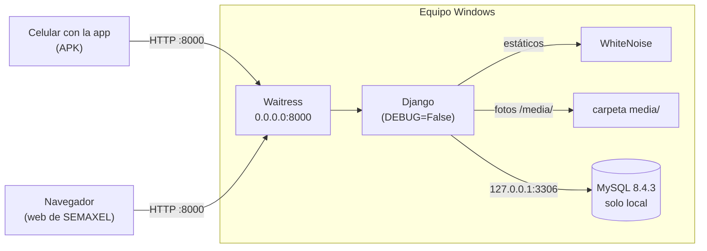

# Guía del servidor de pruebas (Windows + MySQL + Waitress)

Cómo quedó montado, el 15-11-2026, el servidor de pruebas de SEMAXEL en el
equipo Windows, para que la app del técnico y la web se puedan usar desde otros
dispositivos. Complementa la [Guía del entorno](Guia_Entorno_Desarrollo.md) y
la [Bitácora](Bitacora_App_Movil.md) (parte 9).

> **Importante.** Es un servidor **de pruebas y demostración**, no de
> producción: funciona por HTTP (sin cifrar) y usa datos hipotéticos de
> `seed_demo`, cuyos usuarios comparten una contraseña que está escrita en el
> repositorio. Antes de exponerlo a Internet, leer la sección 6.

---

## 1. Arquitectura



| Pieza | Para qué | Dónde |
|---|---|---|
| MySQL 8.4.3 LTS | Base de datos (la 8.0 ya no tiene soporte) | `D:\herramientas-servidor\mysql-8.4.3-winx64` |
| Datos de MySQL | Archivos de la base | `D:\herramientas-servidor\mysql-datos` |
| Waitress 3.0.2 | Servidor web de Python que funciona en Windows (reemplaza a `runserver`, que no es para servir) | Entorno virtual del proyecto |
| WhiteNoise 6.8.2 | Sirve CSS y JS con `DEBUG=False` | Entorno virtual del proyecto |
| `SEMAXEL_SERVIR_MEDIA` | Interruptor nuevo: Django entrega las fotos subidas aunque `DEBUG=False` | `config/settings.py` y `config/urls.py` |

---

## 2. Instalación de MySQL (qué se hizo)

1. Se descargó el ZIP oficial `mysql-8.4.3-winx64.zip` (248 MB) desde
   `dev.mysql.com`. Se verificó que `mysqld.exe` tiene una **firma digital
   válida de Oracle America, Inc.** No se usó el instalador ni se registró como
   servicio de Windows: no cambia nada del sistema.
2. Configuración en `D:\herramientas-servidor\mysql.ini`:

   ```ini
   [mysqld]
   basedir=D:/herramientas-servidor/mysql-8.4.3-winx64
   datadir=D:/herramientas-servidor/mysql-datos
   port=3306
   bind-address=127.0.0.1      # solo este equipo: MySQL no queda expuesto a la red
   mysqlx=OFF
   character-set-server=utf8mb4
   collation-server=utf8mb4_0900_ai_ci
   log-error=D:/herramientas-servidor/mysql-datos/error.log
   tmpdir=D:/herramientas-servidor/tmp
   ```

3. Inicialización: `mysqld --defaults-file=...\mysql.ini --initialize-insecure`.
4. Con un script se generaron claves aleatorias (24 caracteres) y se ejecutó:
   - cambio de la clave de `root`;
   - base `capstone_semaxel` en `utf8mb4`;
   - usuario `semaxel` (solo desde `localhost` y `127.0.0.1`) con todos los
     permisos sobre `capstone_semaxel` y `test_capstone_semaxel` (la base que
     crea Django para las pruebas).
5. **Dónde quedaron las claves** (ninguna está en Git ni en esta guía):
   - clave de `root`: `D:\herramientas-servidor\credenciales\mysql-root.txt`;
   - clave del usuario `semaxel` y `SECRET_KEY` de Django: `D:\proyecto_semaxel\.env`;
   - clave del entorno de QA (todos los usuarios `qa_*`):
     `D:\herramientas-servidor\credenciales\qa.txt` (ver la
     [Guía de pruebas manuales](Guia_Pruebas_QA.md)).

---

## 3. Configuración de Django (`.env`)

El archivo `.env` (no se sube a Git; la plantilla es `.env.example`) quedó con:

| Variable | Valor en este servidor |
|---|---|
| `SECRET_KEY` | aleatoria (generada con `secrets.token_urlsafe(50)`) |
| `DEBUG` | `False` |
| `ALLOWED_HOSTS` | `localhost,127.0.0.1,192.168.100.10,10.0.2.2` (`10.0.2.2` es el computador visto desde el emulador de Android) |
| `DB_*` | base `capstone_semaxel`, usuario `semaxel`, `127.0.0.1:3306` |
| `SEMAXEL_SERVIR_MEDIA` | `True` |
| `SEMAXEL_PUSH_BACKEND` | `consola` (Firebase aún no está configurado) |

`192.168.100.10` es la IP de este equipo en la red local (adaptador
"Ethernet"). Si cambia, o si se entra por otra dirección (VPN, IP pública o
dominio), hay que agregarla a `ALLOWED_HOSTS` y reiniciar el servidor.

---

## 4. Arrancar el servidor

Hay dos scripts en `D:\herramientas-servidor\`. Cada uno queda abierto en su
propia ventana de PowerShell (al cerrarla, se detiene):

1. **`iniciar-mysql.ps1`**: arranca MySQL.

   ```powershell
   & D:\herramientas-servidor\mysql-8.4.3-winx64\bin\mysqld.exe --defaults-file=D:\herramientas-servidor\mysql.ini --console
   ```

2. **`iniciar-servidor.ps1`**: aplica migraciones pendientes, reúne los
   archivos estáticos y arranca Waitress en el puerto 8000.

   ```powershell
   cd D:\proyecto_semaxel
   .\venv\Scripts\python.exe manage.py migrate --noinput
   .\venv\Scripts\python.exe manage.py collectstatic --noinput
   .\venv\Scripts\waitress-serve.exe --listen=0.0.0.0:8000 --threads=8 config.wsgi:application
   ```

Después de reiniciar el equipo hay que volver a ejecutar ambos, en ese orden.
Quedan disponibles:

| Dirección | Qué es |
|---|---|
| `http://192.168.100.10:8000/` | Web de SEMAXEL |
| `http://192.168.100.10:8000/api/v1/` | API de la app |
| `http://192.168.100.10:8000/api/v1/docs/` | Documentación interactiva (Swagger) |

Para recargar los datos de demostración: `python manage.py seed_demo` (la
contraseña común de los usuarios de prueba se muestra al terminar).

---

## 5. Verificación realizada (15-11-2026)

| Prueba | Resultado |
|---|---|
| Suite de pruebas de Django **sobre MySQL 8.4.3** (`manage.py test`) | **195 de 195 pasan** (antes solo se habían corrido con SQLite) |
| `manage.py check --deploy` | 4 avisos, todos de HTTPS (HSTS, redirección SSL, cookies seguras); esperados en un servidor sin HTTPS |
| Web por la IP de la red, con `DEBUG=False` | Login real (con CSRF), dashboard, reportes, tickets, órdenes, ofertas, sucursales y mantenimiento responden 200; CSS servido por WhiteNoise |
| Página inexistente | 404 sin información interna de depuración |
| Prueba de contrato de la app (`ContratoApiTest`) contra Waitress + MySQL por `192.168.100.10` | **Pasa**: login, ofertas, tomar, llegada GPS, iniciar, fotos, firma, resolver y cierre de sesión |
| Descarga de una foto subida (`/media/...`) por la red | 200, `image/jpeg` |

---

## 6. Abrir el acceso desde otros dispositivos (lo hace Sebastián)

Cambiar el firewall de Windows o el router modifica la seguridad del equipo,
así que **no lo hizo la IA**: queda a cargo de Sebastián. Hay tres opciones,
de la más segura a la menos segura.

> **Sin abrir nada:** el emulador de Android del mismo equipo llega al
> servidor por `10.0.2.2` sin tocar el firewall. Ver la sección 3.6 de la
> [Guía del entorno](Guia_Entorno_Desarrollo.md).

### 6.1 Misma red Wi-Fi o cableada (recomendada para probar)

Permitir conexiones entrantes al puerto 8000 en el firewall de Windows. En
PowerShell **como administrador**:

```powershell
New-NetFirewallRule -DisplayName "SEMAXEL pruebas (TCP 8000)" -Direction Inbound -Protocol TCP -LocalPort 8000 -Action Allow -Profile Private
```

El perfil `Private` solo abre el puerto en redes marcadas como privadas (la
casa), no en redes públicas. Para quitar la regla:
`Remove-NetFirewallRule -DisplayName "SEMAXEL pruebas (TCP 8000)"`.

El celular debe estar en la misma red e instalar el APK que apunta a
`192.168.100.10` (sección 7).

### 6.2 Red privada virtual (VPN) ya instalada en el equipo

El equipo ya tiene **ZeroTier** (IP `10.147.17.73`) y **Radmin VPN**
(IP `26.39.142.130`). Si el celular se une a la misma red ZeroTier, puede
entrar a `http://10.147.17.73:8000/` desde cualquier lugar **sin abrir puertos
en el router**. Hay que agregar esa IP a `ALLOWED_HOSTS` y compilar el APK con
esa dirección.

### 6.3 Internet (redirección de puertos en el router)

Redirigir en el router el puerto externo elegido hacia `192.168.100.10:8000`
y agregar la IP pública o el dominio a `ALLOWED_HOSTS`. **Antes de hacerlo:**

- **Cambiar las contraseñas de los usuarios de demostración** o no cargar
  `seed_demo`: su contraseña común está escrita en el repositorio, que es
  público, así que cualquiera podría entrar como administrador.
- Tener en cuenta que el tráfico va sin cifrar (HTTP): el token de la app y
  las contraseñas viajan legibles. Para Internet conviene HTTPS (por ejemplo,
  un túnel con certificado o un proxy inverso con Let's Encrypt).
- MySQL no queda expuesto (escucha solo en `127.0.0.1`).

---

## 7. APK que apunta al servidor

La dirección del servidor queda dentro del APK al compilar. Para la red local
se generó:

```powershell
. D:\herramientas-android\entorno.ps1
cd D:\proyecto_semaxel\app-movil
.\gradlew.bat assembleDebug "-Psemaxel.apiUrl=http://192.168.100.10:8000/"
```

Copia lista para instalar: `D:\herramientas-servidor\apk\SEMAXEL-Tecnico-red-local.apk`
(18 MB, firmada con la clave de depuración). Se instala copiándola al celular
(o con `adb install`) y permitiendo "instalar apps de origen desconocido".

Para otra dirección (VPN o Internet), repetir el comando con
`-Psemaxel.apiUrl=http://<dirección>:<puerto>/`.

---

## 8. Pendientes

| Pendiente | Por qué importa |
|---|---|
| Regla de firewall (sección 6) | Sin ella, otros dispositivos no llegan al puerto 8000. |
| Probar la app en un celular real | Pantallas, cámara, GPS y firma solo se pueden probar en un dispositivo. |
| HTTPS | Necesario si el servidor se publica en Internet. |
| Arranque automático | Hoy MySQL y el servidor se inician a mano con los scripts. |
| Respaldo de la base | `mysqldump` periódico si se cargan datos que importen. |
| Firebase | Las notificaciones push siguen en modo `consola`. |
